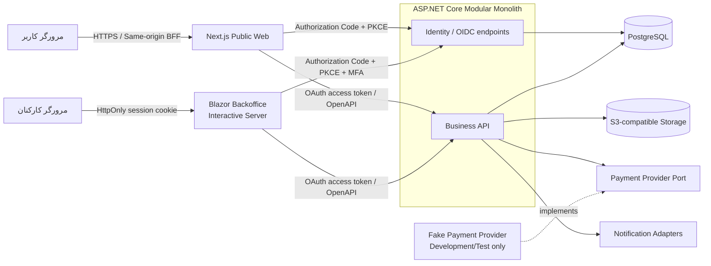
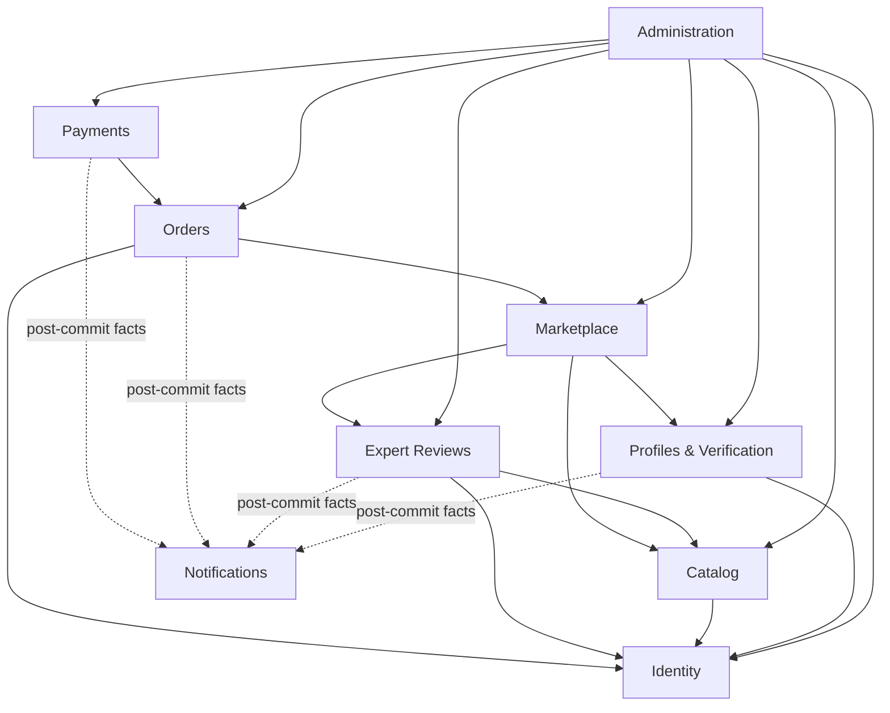
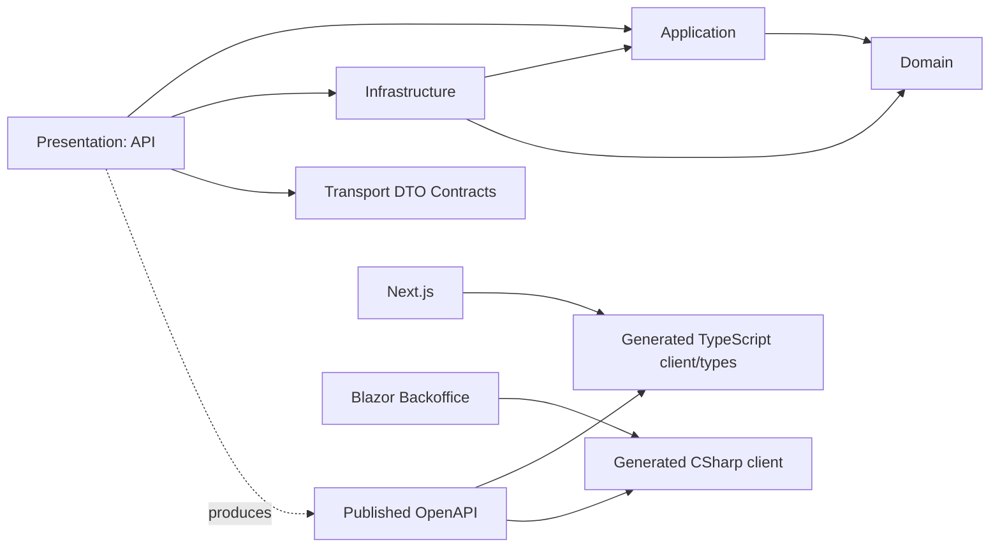

# معماری پیشنهادی بازار هنر — فاز ۰

> وضعیت: **پیشنهادی و در انتظار تأیید**  
> تاریخ: ۲۰۲۶-۱۰-۱۳  
> دامنه این سند: فقط V1؛ هیچ قابلیت، endpoint، جدول یا job مربوط به حراج V2 در این فاز ساخته نمی‌شود.

## ۱. خلاصه تصمیم

V1 به‌صورت یک **Modular Monolith** با مرزهای ماژولی روشن و اصول Clean Architecture ساخته می‌شود. یک Backend مبتنی بر ASP.NET Core 10 مرجع نهایی تمام قوانین کسب‌وکار است. وب عمومی Next.js و Backoffice مبتنی بر Blazor فقط از قراردادهای HTTP/OpenAPI استفاده می‌کنند و به persistence دامنه دسترسی مستقیم ندارند.

در Backend، به‌جای ساختن پروژه مستقل برای تک‌تک ماژول‌ها، چهار لایه اصلی و یک پروژه قرارداد داریم و هر لایه بر اساس ماژول پوشه‌بندی می‌شود. این انتخاب تعداد پروژه‌ها را کنترل می‌کند، در عین حال dependency ruleها با architecture test و conventionهای namespace قابل بررسی می‌مانند.

## ۲. اهداف و محدودیت‌های V1

### در محدوده V1

- گالری عمومی، دسته‌بندی، جست‌وجو، فیلتر، مرتب‌سازی و صفحه جزئیات اثر
- یک حساب مشترک برای خریدار و فروشنده، همراه با verification تدریجی
- ایجاد پیش‌نویس اثر، فایل‌های عمومی و خصوصی، و ارسال برای بررسی
- فرایند کارشناسی با تاریخچه قابل ممیزی
- listing قیمت ثابت فقط برای نسخه تأییدشده اثر
- سبد خرید، رزرو اتمیک، سفارش، حمل پایه و رهگیری وضعیت
- abstraction پرداخت و Fake Provider صرفاً در Development/Test
- پنل مستقل Blazor برای Expert، Admin و SuperAdmin
- لاگ ساخت‌یافته، audit، validation، rate limiting، health check و تست‌های حیاتی
- RTL کامل با زبان پیش‌فرض `fa-IR` و ذخیره زمان‌ها به UTC

### صریحاً خارج از محدوده V1

- حراج زمان‌دار، bid، SignalR برای bidding، anti-sniping و minimum increment
- auction submission، auction lot، eligibility حراج و schedulerهای حراج
- مهلت پرداخت ۱۵ دقیقه‌ای برنده و ارتقای bidder بعدی
- escrow، wallet، تسویه فروشنده، کمیسیون حراج و بیمه حراج
- اتصال به درگاه پرداخت واقعی تا زمان تعیین کشور، provider و الزامات حقوقی
- microservice، message broker، Kubernetes و search engine خارجی بدون شواهد نیاز

## ۳. محرک‌های معماری

1. **درستی مالی و جلوگیری از فروش دوباره:** وضعیت listing و رزرو فقط در Backend و داخل transaction تغییر می‌کند.
2. **جدایی هویت اثر از کانال فروش:** `Artwork`، review و provenance مستقل از `MarketplaceListing` هستند.
3. **قابلیت ممیزی:** تصمیم کارشناسی، تغییر نقش، verification، moderation و عملیات مالی history append-only در سطح application دارند؛ نیاز حقوقی به storage واقعاً tamper-resistant هنوز باید تعیین شود.
4. **امنیت فایل:** تصویر عمومی و سند خصوصی دو مسیر ذخیره‌سازی و دسترسی متفاوت دارند.
5. **قابلیت تکامل:** V2 یک ماژول Auction مستقل اضافه می‌کند؛ Marketplace به Auction تبدیل نمی‌شود.
6. **سادگی عملیاتی V1:** PostgreSQL و S3-compatible storage کافی‌اند؛ Redis فقط با نیاز اندازه‌گیری‌شده اضافه می‌شود.

## ۴. نمای کلان سیستم



مرورگر هرگز token بلندمدت را در `localStorage` دریافت نمی‌کند. جزییات تصمیم احراز هویت در [ADR-0002](decisions/0002-central-oidc-and-bff-sessions.md) آمده است.

## ۵. مرزهای ماژولی

| ماژول | مسئولیت و داده تحت مالکیت | نکته مرزی |
|---|---|---|
| Identity | حساب، credential، role، MFA، session و clientهای OIDC | نقش با verification یکی نیست. |
| Profiles & Verification | پروفایل، نشانی‌ها، درخواست/اسناد verification و `SellerEligibility` versionدار | اسناد verification خصوصی‌اند و eligibility role نیست. |
| Catalog | Artwork، نسخه‌های اطلاعات اثر، Artist، Category، media و provenance reference | مالک هویت اثر است، نه قیمت و فروش. |
| Expert Reviews | پرونده بررسی، findings، decision و history | روی یک `ArtworkRevision` ثابت تصمیم می‌گیرد. |
| Marketplace | listing قیمت ثابت، انتشار، تعلیق، withdrawal و active-offering guard | هیچ مفهوم bid یا auction ندارد. |
| Orders | cart، reservation، order، item/shipping snapshot و `OwnershipTransfer` | قیمت و نشانی هنگام سفارش immutable snapshot می‌شوند. |
| Payments | attempt، provider event، verified receipt، application/reconciliation و provider port | واقعیت receipt از اعمال آن به Order جداست. |
| Administration | orchestration مدیریتی، read model داشبورد، محتوای محدود سایت و audit query | مالک داده دامنه‌های دیگر نیست؛ فقط Content تحت مالکیت خودش است. |
| Notifications | template، delivery attempt و adapter ایمیل/SMS در صورت انتخاب | شکست اعلان نباید transaction مالی را rollback کند. |

### قواعد ارتباط میان ماژول‌ها

- هر ماژول فقط شناسه ماژول دیگر را نگه می‌دارد؛ navigation و write مستقیم به جدول ماژول دیگر ممنوع است.
- هماهنگی synchronous از طریق application contractهای محدود انجام می‌شود.
- برای use caseهایی که اتمیک بودن حیاتی است، orchestration در Application و یک transaction مشترک PostgreSQL استفاده می‌شود.
- event broker یا Domain Event framework در V1 پیش‌فرض نیست. اگر اعلان قابل‌اعتماد لازم شد، یک outbox دیتابیسی و worker درون همان process کافی است.
- Administration از use caseهای ماژول‌ها استفاده می‌کند؛ «دور زدن» rule دامنه با update مستقیم مجاز نیست.



فلش‌ها «استفاده از contract/application service» هستند، نه وابستگی Domain یا دسترسی مستقیم به table.

## ۶. Clean Architecture و dependency rule



- `Domain` فقط به BCL وابسته است و invariant/state transitionها را نگه می‌دارد.
- `Application` use caseها، authorization policyهای کسب‌وکاری و transaction boundary را تعریف می‌کند.
- `Infrastructure` پیاده‌سازی EF Core، Identity، object storage، payment adapter و clock را دارد.
- `Api` transport، status code، Problem Details، OpenAPI و composition root است.
- generic repository ساخته نمی‌شود. برای write model فقط repository/portهای aggregate-specific که seam واقعی ایجاد می‌کنند و برای readها query serviceهای هدفمند استفاده می‌شود.
- CQRS framework، MediatR، AutoMapper و Domain Event framework فقط در صورت وجود مسئله واقعی و ADR جداگانه اضافه خواهند شد.

## ۷. persistence، consistency و concurrency

- PostgreSQL منبع اصلی داده است؛ tableها با schema منطقی هر ماژول (`identity`, `profiles`, `catalog`, `reviews`, `marketplace`, `orders`, `payments`, `admin`) جدا می‌شوند.
- در V1 یک `ArtMarketplaceDbContext` با configurationهای ماژولی پیشنهاد می‌شود تا transactionهای Marketplace/Orders ساده و اتمیک بمانند. مالکیت tableها همچنان با convention و test کنترل می‌شود.
- migrations در Infrastructure نگهداری و در CI روی PostgreSQL واقعی با Testcontainers آزمایش می‌شوند.
- هیچ مبلغی با floating point ذخیره نمی‌شود؛ `amount` از نوع decimal محدود و settlement currency کد پیکربندی‌شده (ISO 4217 در صورت کاربرد provider) است. display unit مانند ریال/تومان و conversion rule جدا و صریح است.
- timestampها `timestamptz`/UTC هستند؛ تاریخ شمسی فقط concern نمایش است.
- برای checkout، update شرطی یا row lock تضمین می‌کند فقط transition از `Published` به `Reserved` موفق شود. Redis lock جایگزین transaction دیتابیس نمی‌شود.
- در checkout چنداثری، listingها همیشه با ترتیب قطعی شناسه lock/update می‌شوند و عملیات all-or-nothing است تا احتمال deadlock و سفارش ناقص کم شود.
- ترتیب سراسری lock برای مسیرهای تجاری `UserAccount/SellerEligibility (UserId مرتب، در صورت نیاز) → Artwork (ArtworkId مرتب) → ReviewCase → MarketplaceListing → Order → Payment records` است. همه عملیات‌هایی که approval، eligibility، عرضه/فروش یا انتقال مالکیت را لمس می‌کنند (`seller/account invalidation`، create/edit/submit revision، create Listing Draft، supersession، publish/reinstate، revision-pin swap، checkout، expiry، manual cancel/release، payment application و `Sold → Completed`) state/ownership/hold/approval را زیر lock دوباره validate می‌کنند. deadlock/serialization failure فقط با retry محدود و idempotent مدیریت می‌شود.
- واحد کار worker expiry یک Order کامل است: ابتدا candidate `OrderId`، seller و همه `ArtworkId`ها از `Order.ReservationExpiresAtUtc`، بدون نگه‌داشتن lock پایین‌دست، خوانده می‌شوند. worker نخست UserAccount/SellerEligibility guard و سپس همه Artwork guardهای مرتب را می‌گیرد؛ `SKIP LOCKED` فقط روی همین guard prefix مجاز است. اگر seller guard یا حتی یک Artwork guard گرفته نشد، transaction بدون mutation rollback/skip می‌شود. سپس Review/Listing/Order قفل و deadline یکتای Order، همه reservationها و holdها دوباره بررسی و all-or-nothing terminal می‌شوند؛ reservation فرزند deadline مستقل ندارد. hold مقصد Listing را `Suspended` می‌کند و هرگز auto-republish/unlock نمی‌کند.
- در V1 یک partial unique index روی `MarketplaceListing(ArtworkId)` برای statusهای non-final (`Draft`, `Published`, `Reserved`, `Suspended`, `Sold`) از چند listing هم‌زمان/فروش دوباره پیش از انتقال مالکیت جلوگیری می‌کند. در V2، جدول مشترک `ArtworkChannelClaim` فقط برای stateهای claim-holding با backfill کنترل‌شده اضافه می‌شود؛ بنابراین V1 هیچ table یا enum حدسی مربوط به Auction نمی‌سازد.
- `MarketplaceListing.PublishedArtworkRevisionId` در Draft قبل از approval تهی است و seller حق مقداردهی مستقیم ندارد؛ use case انتشار زیر commercial guard، decision مؤثر را revalidate و همان revision را همراه `Draft → Published` اتمیک pin می‌کند. این FK برای `Published/Reserved/Suspended/Sold/Completed` اجباری و با check/domain invariant محافظت می‌شود.
- create Draft نیز User/SellerEligibility و Artwork را قفل، owner/capability و نبود listing non-final را زیر lock بررسی و سپس insert می‌کند؛ در V2 نبود claim متعارض هم precondition است. pre-read مالکیت یا اعتماد صرف به unique-index کافی نیست.
- `SellerEligibility` خلاصه canonical و versionدارِ account-active + verification-valid است. هر transition نسخه را افزایشی می‌کند؛ publish نسخه را روی Listing و checkout همان نسخه جاری را یک‌بار روی Order snapshot می‌کند و Reservation فرزند آن را به ارث می‌برد. invalidation در همان transaction یک `SellerEligibilityInvalidation`/outbox work item پایدار با `InvalidatedVersion` می‌سازد؛ هر snapshot با `SnapshotVersion < InvalidatedVersion` پوشش داده می‌شود. reapproval بعدی marker را حذف یا resolve نمی‌کند و resolution فقط append-only، target-specific و ممیزی‌شده است؛ worker idempotent Published را Suspended، Reserved را held و Sold را روی fulfillment/transfer hold می‌گذارد.
- checkout زیر همان lockها باید eligibility جاری را valid بیابد، برای تک‌تک Listingها `SellerEligibilityVersionAtPublish == SellerEligibility.EligibilityVersion` را برقرار کند و نبود invalidation حل‌نشده‌ای را که snapshot را پوشش می‌دهد بسنجد؛ Order موفق همان نسخه را در `SellerEligibilityVersionAtCheckout` می‌گیرد. در mismatch کل checkout بدون Order/Reservation رد و Listingهای stale با audit `Suspended` می‌شوند. reapproval به‌تنهایی Listing قدیمی را قابل‌خرید نمی‌کند؛ فقط reinstate/re-publish ممیزی‌شده می‌تواند markerهای مربوط را resolve و snapshot Listing را به نسخه جاری ببرد.
- version mismatch یا invalidation حل‌نشده برای snapshot Listing یا Order، payment/release/transfer را حتی اگر eligibility فعلی دوباره valid شده باشد fail-closed می‌کند تا resolution ممیزی‌شده. payment هر دو snapshot Listing و Order و برابری آن‌ها را revalidate می‌کند؛ callback مالی receipt را حفظ و reconciliation می‌سازد. Draft/final history بازنویسی نمی‌شود و crash/lag worker پنجره فروش ایجاد نمی‌کند.
- نبود/نامعتبر بودن SellerEligibility پس از lock در expiry مقصد را fail-closed `Suspended` می‌کند. در callback، همین وضعیت application را منع می‌کند ولی receipt معتبر همچنان ثبت و به reconciliation متصل می‌شود؛ داده مالی برای حفظ authorization دور ریخته نمی‌شود.
- هر مسیر به `Published` از policy واحد `CanPublishListingNow` عبور می‌کند: owner فعلی همان seller، account/seller eligibility معتبر، approval مؤثر همان pin، نبود hold/invalidation حل‌نشده و constraint کانال. manual cancel/expiry، Order + همه Reservationها + Listingها را اتمیک می‌بندد و اگر policy برقرار نباشد مقصد Listing `Suspended` است، نه `Published`.
- create/edit/submit revision نیز `User/SellerEligibility → Artwork → ReviewCase` را قفل می‌کند و owner/capability و مالکِ draft را زیر lock دوباره می‌سنجد. انتقال مالکیت یک `OwnershipTransfer` append-only و idempotent می‌سازد که دقیقاً به `OrderItem`, `Listing`, `Artwork` و `OrderPaymentApplication` همان Order متصل است؛ `FromUserId` باید owner/seller جاری و `ToUserId` دقیقاً buyer سفارش باشد. همان transaction، Draftهای mutable مالک قبلی را با reason مالکیت terminal و review بازِ او را withdraw می‌کند، owner را تغییر می‌دهد و `Sold → Completed` را انجام می‌دهد. revision/approval منتشرشده تاریخچه immutable می‌ماند و مالک جدید هیچ Draft یا edit right قبلی را خودکار به ارث نمی‌برد.
- برای هر Artwork حداکثر یک revision mutable در `Draft`، یک ReviewCase non-terminal و در آن حداکثر یک round در `PendingReview` وجود دارد. commandهای create/edit/submit این مجموعه را پس از Artwork lock revalidate می‌کنند و partial unique indexها آخرین guard هستند؛ در دو submit هم‌زمان فقط یکی freeze/round ایجاد می‌کند و دیگری conflict می‌گیرد.
- supersession، case بسته تاریخی را reopen نمی‌کند. زیر همان Artwork/Review lock، supersession append-only و safeguard تجاری اتمیک ثبت می‌شود؛ remediation به case فعال موجود attach یا در نبود آن با case/round جدید ساخته می‌شود. race با submit از طریق reload/retry idempotent به workflow برنده همگرا می‌شود و unique conflict هرگز approval نامعتبر را قابل‌خرید نگه نمی‌دارد.
- نتیجه تأییدشده provider برای هر `PaymentAttempt` مستقل از اثر کسب‌وکاری آن ثبت می‌شود؛ حتی چند دریافت واقعی برای یک Order باید قابل ثبت و reconciliation باشند. پردازش هر receipt از lock order سراسری بالا پیروی و Order را پیش از تصمیم apply/reconcile قفل می‌کند؛ هر `OrderPaymentApplication` به یک `VerifiedPaymentReceiptId` دقیق اشاره می‌کند و unique constraint روی `OrderId` اجازه اعمال وجه فقط یک‌بار را می‌دهد. receipt دوم حفظ و reconcile می‌شود، نه rollback؛ provider transaction id و callback event id نیز در scope provider یکتا هستند.

## ۸. راهبرد فایل و حریم خصوصی

- API فقط metadata و object key را ذخیره می‌کند؛ binary در storage سازگار با S3 قرار می‌گیرد.
- مرز امنیتی با bucket یا policy مستقل برای public derivative، private original/document و quarantine اعمال می‌شود؛ prefix داخل bucket عمومی به‌تنهایی جداسازی امنیتی محسوب نمی‌شود و public ACL ممنوع است.
- upload با presigned intent محدود به key/method/size/type/expiry وارد quarantine خصوصی می‌شود. finalize، intent را در Application تک‌مصرف می‌کند و scanner همان byte stream/version دقیق را با SHA-256 بررسی می‌کند؛ verdict و promotion نباید با fetch دوباره از key قابل overwrite از هم جدا شوند.
- نتیجه پاک فقط با write server-side و create-if-absent به یک clean key جدید، غیرقابل overwrite و خارج از اختیار `Put` کاربر promotion می‌شود؛ asset رکورد `CleanObjectKey`, `Sha256`, size/type و در صورت پشتیبانی `VersionId` را نگه می‌دارد. `Clean` فقط پس از تطبیق hash مقصد ثبت می‌شود و revision هرگز quarantine key را pin نمی‌کند.
- allow-list نوع فایل، کنترل magic bytes، decode واقعی، محدودیت اندازه/تعداد، حذف metadata حساس، re-encode تصویر و اسکن بدافزار لازم است؛ SVG/HTML/archive در V1 پذیرفته نمی‌شوند.
- derivative عمومی فقط server-side از همان clean image تولید و در key جدید ذخیره می‌شود. اگر storage نتواند source version را هنگام copy قطعی pin کند، scan و promotion باید روی همان stream بایت انجام شود؛ ETag به‌تنهایی content hash محسوب نمی‌شود.
- اسناد مالکیت، اصالت و verification هرگز public URL دائمی ندارند؛ دسترسی پس از policy check با URL کوتاه‌عمر یا stream کنترل‌شده صادر می‌شود.
- دسترسی فایل با شناسه object حدس‌پذیر مجاز نیست و هر درخواست در برابر مالک/نقش/پرونده review کنترل می‌شود؛ PDF خصوصی با `attachment`/`nosniff` یا preview sandboxed بدون credential ارائه می‌شود.

### ماتریس اولیه طبقه‌بندی داده

| طبقه | نمونه‌ها | مخاطب مجاز |
|---|---|---|
| Public | revision تأییدشده منتخب، derivative تصویر، Artist bio، price/availability و نام نمایشی seller | همه |
| Account Private | پروفایل کامل، contact، saved address، draftهای خود، cart و orderهای خود | مالک و policyهای پشتیبانی محدود |
| Review Restricted | original image، provenance/ownership document، evidence و comment داخلی review | seller در بخش مجاز، reviewer مجاز و Admin دارای capability |
| Verification Restricted | مدرک هویتی/فروشندگی و decision داخلی | applicant در بخش مجاز و `SellerVerification.Read` |
| Financial Restricted | PaymentAttempt metadata، reconciliation و shipping snapshot | طرف سفارش در DTO محدود و staff دارای capability |
| Security/Audit Restricted | role change، session/security event و audit metadata | `Audit.Read`/SuperAdmin با redaction |
| Secret | password hash، token، signing key، provider secret و signed URL | هرگز در DTO/log؛ فقط component مسئول/secret store |

DTOهای Public/User/Reviewer/Admin جدا هستند؛ «فیلد اضافه و مخفی‌کردن در UI» کنترل دسترسی محسوب نمی‌شود.

## ۹. قرارداد API و frontendها

- API با OpenAPI نسخه‌بندی‌شده، `ProblemDetails` استاندارد و pagination cursor/page قراردادی منتشر می‌شود.
- Backoffice و Next.js برای داده دامنه فقط API را صدا می‌زنند؛ query جدول‌های کسب‌وکار در UI وجود ندارد. BFF هر frontend فقط می‌تواند session store فنی و جداگانه خودش را داشته باشد.
- Typeهای TypeScript و client Backoffice از OpenAPI تولید یا در CI با آن تطبیق داده می‌شوند تا drift مشخص شود.
- Server Component پیش‌فرض صفحات read-heavy است؛ Client Component فقط برای interaction، browser API یا state محلی استفاده می‌شود.
- TanStack Query برای داده‌های client-interactive و mutationهایی که cache/refetch لازم دارند استفاده می‌شود، نه برای هر fetch سروری.
- React Hook Form + Zod برای تجربه فرم سمت کاربر است؛ validation نهایی دوباره در Backend اجرا می‌شود.
- همه layoutها از ابتدا `lang="fa-IR"` و `dir="rtl"` دارند و CSS logical properties ترجیح داده می‌شود.

## ۱۰. راهبرد احراز هویت و مجوزدهی

قرارداد قطعی پیشنهادی، OIDC + BFF است؛ محصول IdP هنوز gate تصمیم Phase 2 است. baseline self-hosted، ASP.NET Core Identity + OpenIddict است و IdP مدیریت‌شده فقط پس از بررسی کشور، data residency، هزینه و دسترس‌پذیری جایگزین می‌شود.

1. سه نشست مستقل وجود دارد: IdP، Public BFF و Backoffice. cookie مشترک parent-domain یا key ring مشترک بین frontendها نداریم.
2. auth host مالک UI و endpointهای credential، register، recovery و MFA است. routeهای `/login` و `/register` در Public فقط entry/return تجربه برندشده‌اند و password را دریافت نمی‌کنند. cookie IdP فقط در auth host معتبر است؛ عبارت «API فقط Bearer» به business API اشاره دارد، نه endpointهای خود IdP.
3. هر دو frontend از Authorization Code + PKCE با `state`, `nonce` و redirect URI دقیق استفاده می‌کنند؛ implicit/password flow ممنوع است.
4. cookie مرورگر فقط یک handle تصادفی opaque و پرآنتروپی (bearer) با `HttpOnly`, `Secure`, `SameSite=Lax`, `Path=/` و بدون `Domain` است؛ DB فقط HMAC/hash همان handle را نگه می‌دارد و مقدار raw هرگز در DB/log ثبت نمی‌شود. tokenها رمز‌شده در session store فنی اختصاصی هر BFF می‌مانند و خطای store/decrypt هیچ fallback به in-memory یا cookie خودبسنده ندارد.
5. برای baseline self-hosted، reference access/refresh token با TTL محدود، refresh rotation و reuse detection ترجیح دارد. اگر JWT انتخاب شود، TTL کوتاه و راهبرد revocation/authz-version صریح لازم است؛ security stamp به‌تنهایی JWT صادرشده را باطل نمی‌کند.
6. API فقط Bearer می‌پذیرد و `issuer`, `audience`, `scope`, `azp/client_id`, account status و policyهای role + verification + ownership را بررسی می‌کند. endpointهای حساس authorization state جاری را دوباره می‌خوانند.
7. BFF proxy catch-all نیست: مسیر/متد/scope allow-list می‌شود، headerهای ورودی حساس حذف می‌شوند، destination از ورودی کاربر ساخته نمی‌شود، body limit وجود دارد و پاسخ authenticated `no-store` است. هر Route Handler/Server Action حساس session را بررسی می‌کند.
8. mutationهای cookie-authenticated، login و logout به anti-CSRF session-bound و بررسی دقیق `Origin`/Fetch Metadata نیاز دارند؛ SameSite دفاع تکمیلی است. API اصلی CORS credentialed عمومی ندارد.
9. Backoffice client باید MFA را در flow درخواست کند و API `acr/amr` را enforce کند. عملیات حساس SuperAdmin به `auth_time` تازه/step-up نیاز دارد؛ idle/absolute timeout و revalidation کوتاه Blazor در Phase 2 نهایی می‌شوند.
10. logout، disable account، تغییر role/MFA و refresh-token reuse sessionهای مربوط را revoke می‌کنند؛ نبود کلیدهای لازم باید startup/runtime را fail-closed کند و key rotation، backup و patch ownership بخشی از gate IdP است.

این طرح SSO کنترل‌شده، deployment مستقل frontendها و حذف token از JavaScript را فراهم می‌کند. هزینه آن، نگهداری امن authorization/session/key lifecycle است؛ در Phase 2 باید threat model و تست flow قبل از توسعه کامل تأیید شود.

### ماتریس اولیه مجوزها

| قابلیت | policy لازم | mapping پیش‌فرض V1 |
|---|---|---|
| Browse public catalog | Anonymous | Visitor/User/Staff |
| Manage own profile/address | Authenticated + resource owner | User و همه staff برای حساب خود |
| Checkout | `CanCheckout` + مالکیت Cart/Address + contact/address completeness + `BuyerUserId != SellerUserId` | User |
| Create/submit artwork | `Artworks.Submit` + seller verification معتبر | User دارای seller capability |
| Decide review | `Reviews.Decide` + assignment/conflict check + MFA | Expert |
| Decide seller verification | `SellerVerification.Decide` + MFA | Admin |
| Manage category/content | `Catalog.Manage` / `Content.Manage` + MFA | Admin |
| Suspend/reinstate listing | `Listings.Moderate` + reason + MFA | Admin |
| View/manage orders | `Orders.Read/Manage` + purpose/resource policy | Admin؛ seller/buyer فقط scope خود |
| Monitor payment/reconcile | `Payments.Read/Reconcile` + step-up برای mutation | Admin محدود |
| Read audit | `Audit.Read` + redaction | Admin/SuperAdmin |
| Assign privileged role/config | `Security.Administer` + fresh step-up | SuperAdmin |

نام role به‌تنهایی مجوز نیست؛ mapping role→permission seed اولیه است و API capability و resource policy را اعمال می‌کند. Admin صرفاً به دلیل role حق تصمیم کارشناسی ندارد.

## ۱۱. قرارداد اولیه طراحی UI/UX

- جهت بصری «گالری معاصر editorial» است، نه template فروشگاهی عمومی.
- tokenهای رنگ اولیه: canvas گرمِ نزدیک سفید، متن charcoal، خاکستری خنثی و accent برنزی محدود؛ contrast باید پیش از نهایی‌شدن اندازه‌گیری شود.
- Vazirmatn با license ثبت‌شده و fallbackهای مناسب فارسی استفاده می‌شود؛ display typography نباید خوانایی متن بلند را کاهش دهد.
- spacing سخاوتمند، border ظریف، shadow کم و motion کوتاه و قابل غیرفعال‌سازی با `prefers-reduced-motion` است.
- design tokenها با CSS custom property و logical propertyها مشترک‌اند؛ Public و Backoffice می‌توانند density متفاوت ولی زبان بصری هماهنگ داشته باشند.
- breakpointهای دقیق در Phase 1 تثبیت می‌شوند، اما QA اجباری در عرض‌های نماینده mobile، tablet و desktop انجام می‌شود.
- image ratio/derivativeها از ابتدا قراردادی‌اند تا layout jump کم شود؛ `alt` معنی‌دار و placeholder مناسب لازم است.
- email، URL، account id و product code با `bdi`/`dir="ltr"` درون layout RTL نمایش داده می‌شوند؛ number/currency/date formatter از locale/config می‌آید.
- status تنها با رنگ منتقل نمی‌شود و focus indicator حذف نمی‌گردد.

## ۱۲. ساختار پیشنهادی repository

وضعیت فعلی دقیق:

- workspace: `D:\Projects\Auction`
- solution/doc root فعلی: `D:\Projects\Auction\Auction`
- solution خالی فعلی: `D:\Projects\Auction\Auction\Auction.sln`
- هیچ Git repository در این دو سطح شناسایی نشده است.

پیشنهاد Phase 1 این است که ساختار redundant تو‌در‌تو حذف و `${REPO_ROOT}=D:\Projects\Auction` شود و نام solution خنثی `ArtMarketplace.sln` انتخاب گردد. این جابه‌جایی فقط پس از تأیید کاربر انجام می‌شود. ساختار هدف:

```text
${REPO_ROOT}/
├─ ArtMarketplace.sln
├─ global.json
├─ Directory.Build.props
├─ Directory.Packages.props
├─ .editorconfig
├─ .env.example
├─ src/
│  ├─ Backend/
│  │  ├─ ArtMarketplace.Domain/
│  │  │  ├─ Common/{EntityId,Money}/
│  │  │  └─ Modules/{Identity,Profiles,Catalog,Reviews,Marketplace,Orders,Payments,Administration,Notifications}/
│  │  ├─ ArtMarketplace.Application/
│  │  │  └─ Modules/...
│  │  ├─ ArtMarketplace.Infrastructure/
│  │  │  └─ Modules/...
│  │  ├─ ArtMarketplace.Contracts/
│  │  └─ ArtMarketplace.Api/
│  ├─ Frontend/
│  │  ├─ PublicWeb/
│  │  └─ Backoffice/
├─ tests/
│  ├─ ArtMarketplace.Domain.Tests/
│  ├─ ArtMarketplace.Application.Tests/
│  ├─ ArtMarketplace.IntegrationTests/
│  ├─ ArtMarketplace.ArchitectureTests/
│  ├─ ArtMarketplace.PublicWeb.Tests/
│  └─ ArtMarketplace.Backoffice.Tests/
├─ deploy/
│  ├─ docker-compose.yml
│  └─ containers/
├─ docs/
│  ├─ decisions/
│  ├─ architecture.md
│  ├─ domain-model.md
│  ├─ implementation-plan.md
│  ├─ v2-readiness.md
│  ├─ progress.md
│  ├─ learning-notes.md
│  └─ known-issues.md
└─ .github/workflows/ci.yml
```

در V1 پروژه `BuildingBlocks` جدا ساخته نمی‌شود. primitiveهای واقعی دامنه مانند `Money` در `Domain/Common`، clock port در `Application/Common` و transport result در لایه مربوط می‌مانند؛ تنها با وابستگی واقعی چند deployable، ADR جداگانه برای استخراج نوشته می‌شود.

## ۱۳. تصمیم‌های فناوری

| حوزه | تصمیم پیشنهادی | دلیل |
|---|---|---|
| Runtime | .NET 10 LTS، با آخرین patch پشتیبانی‌شده در زمان Phase 1 | طبق policy رسمی تا نوامبر ۲۰۲۸ پشتیبانی می‌شود. |
| Node runtime | یک خط LTS پشتیبانی‌شده (ترجیح فعلی Node 24؛ پس از compatibility check) | Node 20 نصب‌شده از ۲۴ مارس ۲۰۲۶ EOL است. |
| API | ASP.NET Core Web API + OpenAPI | transport استاندارد و مستقل از UI |
| Data | EF Core + Npgsql + PostgreSQL | transaction، constraint و concurrency مناسب |
| Public UI | Next.js App Router + TypeScript + Tailwind + shadcn/ui | SSR/RSC، SEO و UI قابل نگهداری |
| Backoffice | Blazor Web App / Interactive Server | workflow احراز‌شده و سازگار با تجربه تیم |
| Validation | Domain invariant + FluentValidation در boundaryهای پیچیده | validation سمت UI جای rule سرور را نمی‌گیرد. |
| Logging | Serilog JSON + correlation/trace id | جست‌وجوی رخدادها بدون ثبت secret/PII |
| Testing | xUnit + Testcontainers + architecture tests | تست روی PostgreSQL واقعی و ruleهای dependency |
| Storage | abstraction سازگار با S3؛ پیاده‌سازی local در Phase 1 پس از بررسی license/provenance/patching انتخاب و digest آن pin می‌شود | جدایی از vendor؛ MinIO به‌عنوان پیش‌فرض فرض نمی‌شود. |
| Search V1 | PostgreSQL full-text/trigram در صورت نیاز واقعی | جلوگیری از search cluster زودهنگام |
| Cache | بدون Redis در ابتدا | هیچ نیاز اثبات‌شده V1 وجود ندارد. |

نسخه دقیق npm/NuGet در Phase 1 پس از اجرای compatibility spike قفل می‌شود؛ از wildcard و `latest` در فایل‌های package استفاده نخواهد شد.

منابع رسمی مرتبط: [.NET support policy](https://dotnet.microsoft.com/en-us/platform/support/policy/dotnet-core)، [Node.js EOL](https://nodejs.org/en/about/eol)، [ASP.NET Core Identity](https://learn.microsoft.com/en-us/aspnet/core/security/authentication/identity?view=aspnetcore-10.0)، [ASP.NET Core antiforgery](https://learn.microsoft.com/aspnet/core/security/anti-request-forgery)، [OpenIddict](https://documentation.openiddict.com/)، [Next.js Server and Client Components](https://nextjs.org/docs/app/getting-started/server-and-client-components) و [Next.js BFF guide](https://nextjs.org/docs/app/guides/backend-for-frontend).

## ۱۴. ابهام‌ها، فرض‌ها و ریسک‌های مهم

| موضوع | پیشنهاد/فرض فعلی | زمان تصمیم نهایی |
|---|---|---|
| کشور، ارز، مالیات و مقررات فروش هنر | currency قابل تنظیم؛ هیچ tax/settlement قانونی حدس زده نشود | پیش از Phase 6 و الزامی پیش از پرداخت واقعی |
| معیار verification فروشنده | workflow عمومی با checklist قابل پیکربندی؛ نوع مدرک هنوز باز | پیش از Phase 2 |
| topology دامنه‌ها | `www`، `auth/api` و `admin` زیر یک parent domain؛ HTTPS اجباری | پیش از Phase 1/2 |
| سبد چندفروشنده | هر cart/order فقط یک فروشنده؛ چند اثر همان فروشنده مجاز | ADR-0004؛ نیازمند تأیید محصول |
| مدت reservation | مقدار config؛ عدد نهایی از UX/provider پرداخت می‌آید | پیش از Phase 6 |
| بازگشت، لغو، refund و اختلاف | هنوز policy محصول/حقوقی ندارد | پیش از Phase 6/7 |
| تغییر اطلاعات اثر تأییدشده | revision جدید و review مجدد؛ listing فعلی روی snapshot تأییدشده می‌ماند | پیش از Phase 3 |
| اطلاعات تماس لازم برای خرید | email/phone/address دقیق هنوز باید با نیاز حقوقی و حمل تعیین شود | پیش از Phase 2/6 |
| تعریف Artist | Artist مستقل از Seller؛ پروفایل curated اختیاری | پیش از Phase 3 |
| حمل، هزینه، محدوده و مسئولیت خسارت | snapshot پایه؛ محاسبه و SLA هنوز باز | پیش از Phase 6 |
| retention اسناد خصوصی و audit | policy حذف/نگهداری باید حقوقی تعیین شود | پیش از Phase 2/3 |
| درگاه پرداخت | فقط port و fake development؛ production provider ممنوع | پیش از فعال‌سازی production payment |
| اعلان‌ها | کانال و provider هنوز انتخاب نشده؛ transaction اصلی به آن وابسته نیست | پیش از Phase 4 |
| تقویم و اعداد | ذخیره UTC/لاتین؛ نمایش locale-configurable و در صورت نیاز شمسی | پیش از UI نهایی Phase 5 |

ریسک‌های با شدت بالا عبارت‌اند از self-hosted OIDC بدون بازبینی امنیتی، نهایی نبودن مقررات پرداخت/KYC، فایل‌های خصوصی، IDOR در endpointهای seller/admin، race condition رزرو، و تغییر محتوای تأییدشده بدون revision. mitigation هر مورد در backlog و [known issues](known-issues.md) ثبت شده است.

## ۱۵. معیار پذیرش فاز ۰

- scope V1 و موارد خارج از scope V2 مشخص است.
- مرز ماژول‌ها، dependency rule و repository structure قابل تأیید است.
- مدل دامنه، ER اولیه، state machineها و invariantهای حیاتی مستند شده‌اند.
- راهبرد authentication/authorization و tradeoffها ثبت شده‌اند.
- backlog فازهای ۱ تا ۹ و acceptance criteria تعریف شده‌اند.
- مسیر تکامل به V2 بدون پیاده‌سازی قابلیت V2 روشن است.
- ریسک‌ها و تصمیم‌های باز صاحب و deadline تصمیم دارند.

پس از تأیید این بسته معماری، Phase 1 آغاز می‌شود. تا پیش از آن هیچ production application code نوشته نمی‌شود.
