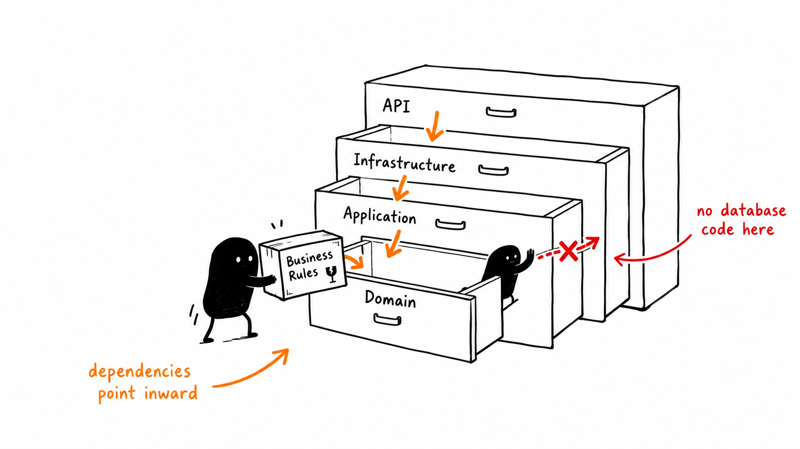
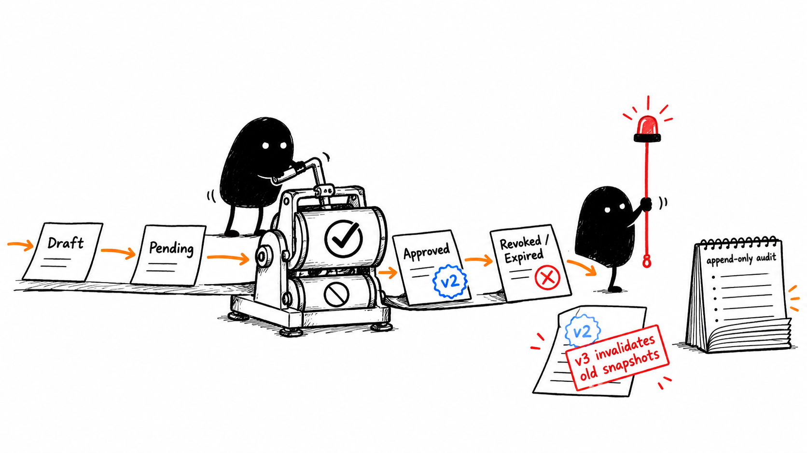
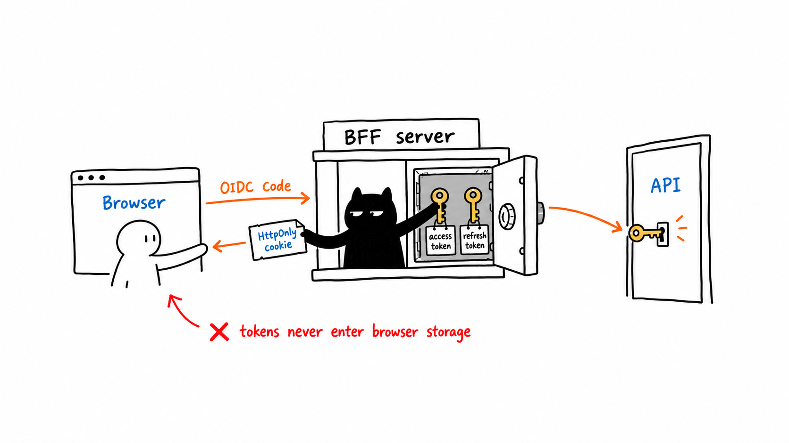
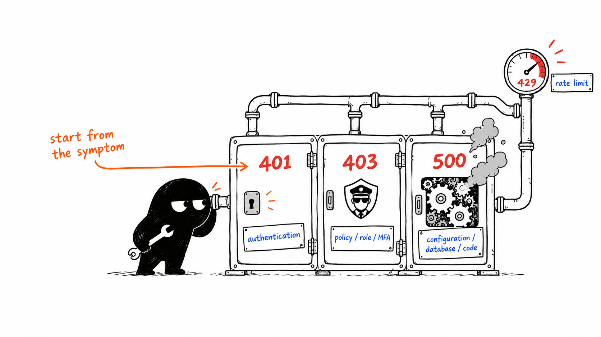

# Art Marketplace Backend — A Developer's Learning Guide

This guide explains what currently exists, why it was written this way, how a request moves through the system, and where to look when something fails.

> Current scope: the repository contains the Phase 1 foundation and the Phase 2 identity/profile/seller-verification implementation. Catalog, artwork upload, review, fixed-price listings, cart, orders, and payments are architecturally designed but are not production code yet. Do not confuse the design documents with implemented features.

## 1. The mental model

The solution is a **modular monolith**. It is deployed as several web processes, but the business backend is organized as one codebase with explicit module and layer boundaries.

The main rule is:

> Business rules point inward. Framework and database details stay outside the domain.



The backend layers are:

| Project | Responsibility | Why it exists |
|---|---|---|
| `ArtMarketplace.Domain` | Business concepts, invariants, and legal state transitions | Business rules remain testable without ASP.NET Core, EF Core, PostgreSQL, or HTTP. |
| `ArtMarketplace.Application` | Use-case contracts and authorization concepts | The inner application describes what it needs; outer infrastructure supplies the implementation. |
| `ArtMarketplace.Infrastructure` | PostgreSQL, EF Core, Identity persistence, secure sessions, health checks, and time implementations | Technology-specific code is replaceable and cannot leak into the domain. |
| `ArtMarketplace.Contracts` | Public transport DTOs | HTTP contracts can be shared/generated without exposing domain or EF entities. |
| `ArtMarketplace.Api` | HTTP pipeline, authentication, authorization, rate limits, endpoints, status codes | This is the public business API and composition root. |
| `ArtMarketplace.Identity` | Login UI, ASP.NET Core Identity, OpenIddict/OIDC server, token issuance | Authentication is centralized instead of being reimplemented by every UI. |
| `PublicWeb` | Next.js public UI and its server-side BFF | Browser tokens are replaced by an opaque, secure cookie. |
| `Backoffice` | Blazor staff UI and its server-side BFF | Staff access gets a separate security boundary with role and MFA requirements. |

The project-reference direction enforces that design:

```text
Domain             -> nothing in the solution
Application        -> Domain
Infrastructure     -> Application + Domain
Contracts          -> nothing in the solution
API                -> Application + Infrastructure + Contracts
Identity           -> Application + Domain + Infrastructure
```

This is why a domain class must never inject `MarketplaceDbContext`, read configuration, or return an HTTP result. Those are outer-layer concerns.

## 2. How the running system fits together

```text
Public browser
  -> Next.js BFF
  -> Identity/OIDC for login
  -> API with a server-held access token

Staff browser
  -> Blazor Backoffice BFF
  -> Identity/OIDC for login + mandatory MFA
  -> API with a server-held access token

Identity + API + both BFFs
  -> PostgreSQL

API
  -> SeaweedFS (S3-compatible storage; only a readiness check exists so far)
```

PostgreSQL is deliberately authoritative. Redis, a message broker, microservices, and a separate search engine were not added because V1 does not yet need their operational cost.

## 3. Repository-level configuration

### `global.json`

The file pins SDK `10.0.401`, permits only a newer patch in that feature band, and searches `.tools/dotnet10` before the machine-wide SDK.

Purpose: every developer and CI build uses the same compiler/runtime behavior. The `paths` entry is also why restoring the repository-local SDK fixed the earlier “Unable to resolve the .NET SDK version” error.

Useful checks:

```powershell
dotnet --version
dotnet --info
dotnet build ArtMarketplace.sln -c Release
```

If `dotnet --version` does not resolve `10.0.401`, inspect `global.json`, `.tools/dotnet10`, and the installed SDK list before debugging project code.

### `Directory.Build.props`

- `Nullable=enable`: makes missing/null data explicit in types.
- `TreatWarningsAsErrors=true`: prevents warning debt from silently entering the codebase.
- `AnalysisLevel=latest-recommended`: enables modern analyzer rules.
- `Deterministic=true`: makes builds reproducible.
- `RestorePackagesWithLockFile=true`: requires dependency lock files.

Purpose: these are solution-wide quality controls. They are centralized so a new project cannot accidentally use weaker settings.

### `Directory.Packages.props`

This is central package management. Project files declare package names; this file owns versions.

Purpose: OpenIddict, EF Core, ASP.NET Core, Npgsql, test libraries, and logging packages cannot drift to incompatible versions across projects.

## 4. Domain layer: where the business truth lives

The domain is intentionally small because only Phase 2 is implemented.

### `EntityId`

`EntityId` is a strongly shaped wrapper around `Guid` with a `New()` factory.

Purpose: it demonstrates value-oriented identifiers and avoids scattering identifier creation syntax. It is not yet widely adopted, so most current aggregates still use `Guid` directly.

### `Money`

`Money` is an immutable record containing `Amount` and `Currency`.

Its constructor rejects:

- negative values;
- currency codes that are not exactly three uppercase ASCII letters.

Purpose: invalid money must be impossible to construct. `decimal` is used because floating-point values are unsafe for exact financial amounts. Price is not placed on `Artwork`; future listing/order records will own commercial snapshots.

### `UserProfile`

This owns a user's display name, locale, and optional public seller biography.

Important design details:

- `private set` prevents arbitrary mutation from other code.
- `Update()` is the supported state-change operation.
- input is trimmed and length-checked inside the entity.
- the parameterless constructor is private for EF Core materialization.

Purpose: validation remains true whether the entity is changed from an API, a background worker, or a future administrative use case.

### `SavedAddress`

This stores a reusable profile address. The constructor requires nonempty identifiers and validates each text field.

Purpose: the current feature is profile address management. A future order must copy an immutable shipping snapshot; it should not keep reading this mutable address after checkout.

### `SellerVerificationCase`

This is a state machine, not a database-shaped data bag.

```text
Draft -> Pending -> Approved
  ^         |          |
  |         +-> ChangesRequested
  |         +-> Rejected
  |                    +-> Revoked
  |                    +-> Expired
  +---- resubmit from ChangesRequested
```

Methods such as `Submit`, `Approve`, `Reject`, `RequestChanges`, `Revoke`, and `Expire` enforce allowed transitions. `EnsureStatus()` rejects illegal transitions. Every successful transition increments `Version` with `checked`, so overflow cannot silently wrap.

Purpose: an endpoint cannot accidentally approve a draft that was never submitted or approve an already approved case. `Version` also supports optimistic concurrency: a reviewer must decide the version they actually saw.

### `SellerEligibility`

Verification history and current selling capability are deliberately separate.

`SellerEligibility` is the canonical current answer to “may this account sell now?” It combines:

- account enabled status;
- verification approval;
- verification expiry;
- monotonically increasing `EligibilityVersion`.

`CanSellAt(now)` is the central predicate. Approving, revoking, disabling, or expiring changes the version.

Purpose: future listings and orders can capture the eligibility version used at publication/checkout. If a seller is later revoked, old commercial snapshots can be recognized as stale even if the seller is approved again afterward.



### `SellerEligibilityInvalidation` and resolution

An invalidation records the new version, reason, user, and time. `Covers(snapshotVersion)` returns true when an old snapshot predates the invalidation.

A resolution is append-only and target-specific. The same invalidation may affect several future listings/orders; resolving one target must not silently clear all others. Duplicate resolution of the same target is rejected.

Purpose: reapproval does not erase history, and a delayed worker cannot create a temporary selling window. This is a fail-closed model designed for later commerce phases.

## 5. Application layer: ports and policy names

The current Application project contains boundaries rather than full use-case handlers.

### `IClock`

This abstracts current UTC time.

Purpose: business code and tests should be able to use a fake clock instead of depending directly on wall-clock time. Infrastructure supplies `SystemClock`.

### `ISellerEligibilityGate`

The interface asks whether a user is eligible and optionally checks a previously captured eligibility version. It returns a decision object containing:

- allowed/denied;
- current version;
- whether a snapshot was invalidated;
- a diagnostic reason.

Purpose: future publish, checkout, payment, and ownership-transfer use cases can depend on a business-facing port without knowing how PostgreSQL is queried.

### `MarketplacePolicies`

This holds stable policy names such as `staff-with-mfa`, `verify-sellers`, and `superadmin-with-mfa`.

Purpose: avoid duplicated magic strings between endpoint registration and UI applications.

## 6. Infrastructure layer

### `DependencyInjection.AddInfrastructure`

This extension is the infrastructure composition module. It:

1. reads the required PostgreSQL connection string;
2. registers `MarketplaceDbContext` with Npgsql;
3. binds the clock and seller-eligibility implementations;
4. validates object-storage configuration at startup;
5. creates a short-timeout HTTP client for storage health checks;
6. registers liveness and readiness probes.

Purpose: `Api/Program.cs` says “add infrastructure” without knowing construction details. Missing critical configuration fails at startup, not during a customer request.

### `MarketplaceDbContext`

The context inherits from `IdentityDbContext`, so one PostgreSQL transaction can contain Identity, profile, verification, audit, and outbox writes.

`OnModelCreating` has several jobs:

- calls `base.OnModelCreating` so ASP.NET Identity is configured;
- calls `UseOpenIddict<Guid>()` for OpenIddict persistence;
- assigns logical schemas (`identity`, `profiles`, `platform`);
- configures keys, indexes, max lengths, enum conversion, concurrency tokens, and relationships;
- prevents cascading deletion of invalidation history.

The `SaveChanges` overrides call `EnforceAppendOnlyAudit()`. Any attempted update/delete of `SecurityAuditEvent` throws.

Purpose: domain validation protects object behavior, while database mapping adds storage constraints, query indexes, concurrency checks, and audit immutability. Both layers are necessary.

### `ApplicationUser`

This extends Identity's user with:

- `IsEnabled`: immediate account disable switch;
- `AuthorizationVersion`: a version that can invalidate stale authorization state.

Purpose: deleting users or relying only on role claims is unsafe. Explicit status/version fields support revocation and later token/session checks.

### `PostgresTicketStore` and `BffSession`

The Backoffice cookie contains only a random handle. The actual authentication ticket is:

- encrypted using ASP.NET Data Protection;
- stored in PostgreSQL;
- located by an HMAC-SHA256 digest of the handle;
- separated by `Surface` (`backoffice`, public surfaces, etc.);
- bounded by expiry and revocation timestamps;
- versioned for concurrent updates.

If decryption fails, the session is revoked instead of being trusted.

Purpose: stealing the database does not reveal plaintext tickets; stealing a digest does not recreate the browser handle; stealing the cookie does not expose OAuth tokens directly.

### `SellerEligibilityGate`

The implementation reads the current eligibility without tracking, checks for any invalidation covering the captured version, and evaluates expiry using `TimeProvider`.

Purpose: this is the concrete PostgreSQL adapter for the Application interface. It returns denied when eligibility is missing—security-sensitive decisions fail closed.

### `SecurityAuditEvent`

This records actor, subject, event type, structured JSON data, trace ID, and UTC time.

Purpose: sensitive administrative decisions must be attributable and traceable. Only minimal metadata is stored to reduce accidental PII leakage.

### `OutboxMessage`

An outbox row stores a fact in the same database transaction as the business change. `PublishedAtUtc` and `Attempts` are reserved for a dispatcher.

Purpose: if verification is approved/revoked, downstream work should not be lost between database commit and message handling. The dispatcher is not implemented yet, so rows are durable but not currently delivered.

### Health checks

- `/health/live` asks only whether the process is alive.
- `/health/ready` checks PostgreSQL and object storage.

Purpose: orchestration should restart a dead process, but should stop routing traffic to a live process whose dependencies are unavailable.

## 7. Identity service, section by section

### Configuration and database

`Identity/Program.cs` requires the database connection immediately and registers the same `MarketplaceDbContext` plus OpenIddict entities.

Why: authentication data and application identity/profile data share consistent identifiers and transactional storage in V1.

### ASP.NET Core Identity options

The code requires confirmed email, unique email, a strong 12-character password policy, and lockout after five failures for 15 minutes.

Why: these are server-enforced controls. Client-side validation is only usability; it is not a security boundary.

### Identity cookie

The cookie uses a `__Host-` name, no domain, path `/`, `HttpOnly`, `Secure=Always`, `SameSite=Lax`, a 30-minute fixed lifetime, and no sliding extension.

Why: host-only cookies reduce cross-subdomain exposure; JavaScript cannot read `HttpOnly`; HTTPS is mandatory; a fixed lifetime limits indefinite session extension.

### Certificates

`CertificateLoader.LoadRequired` loads separate signing and encryption PFX certificates, requires a private key, and fails startup when a file is absent or invalid.

Why: token signing/encryption must never silently fall back to an ephemeral development key in a deployable environment.

### OpenIddict server

The server exposes authorization, token, logout, introspection, revocation, and user-info endpoints. It permits only authorization-code and refresh-token flows, requires PKCE, creates short-lived 10-minute access tokens, and uses opaque reference access/refresh tokens.

Why:

- Authorization Code + PKCE protects code interception.
- No implicit flow means tokens are not returned through browser URLs.
- Reference tokens can be centrally revoked/introspected.
- Short access-token life reduces exposure.

### Middleware order

The order is significant:

```text
HTTPS/static/localization -> routing -> rate limiting
-> authentication -> authorization -> controllers/pages
```

Authentication must run before authorization. Endpoint mappings come after middleware registration. Moving these casually can cause unexplained 401/403 behavior.

### `AuthorizationController`

`AuthorizeEndpoint()`:

1. reads the validated OpenIddict request;
2. challenges the Identity cookie when the user is not logged in;
3. reloads the user from the database;
4. rejects disabled or otherwise non-signable accounts;
5. ensures the baseline `User` role;
6. requires MFA when any staff role is present;
7. builds a fresh claims principal and issues the authorization response.

`Exchange()` handles authorization-code and refresh-token exchange. It reloads the user and validates the Identity security stamp, so a password/security change can invalidate a previously issued grant.

`CreatePrincipalAsync()` deliberately reconstructs claims. It sets subject, name, email verification, authorization version, authentication time, assurance level (`acr`), and authentication methods (`amr`), then limits claim destinations.

Purpose: never copy an old principal blindly. Current database state must decide what enters a new token.

### Seed service

`IdentitySeedService` idempotently creates roles, two confidential BFF clients, and the API introspection client. It never creates a default administrator/password. It only promotes an existing confirmed, MFA-enabled account matching configured email.

Purpose: startup is repeatable without shipping default credentials. Changing an already-seeded client in configuration does not update its existing database registration; an explicit rotation/update operation is needed.

### Expiration worker

`SellerVerificationExpirationService` runs at startup and hourly. It finds due approved cases, transitions the case to Expired, invalidates eligibility, writes an audit event, and adds an outbox message before one `SaveChangesAsync`.

Purpose: all effects commit together. A concurrency/database exception is treated as another replica possibly winning the race. At larger scale this worker will need bounded batches and stronger row-claiming behavior.

## 8. API service, section by section

### Logging and errors

Serilog writes compact JSON and enriches every record with `Service=ArtMarketplace.Api`. `AddProblemDetails` plus `UseExceptionHandler` provides consistent error responses.

Purpose: structured logs can be queried by service, trace, status, and event instead of scraping free text. Unhandled exceptions do not leak stack traces to clients.

### Reference-token validation

The API uses OpenIddict validation with:

- exact issuer;
- required `art-marketplace-api` audience;
- introspection client credentials;
- HTTP calls back to Identity.

Purpose: access tokens are opaque reference values. The API asks the authority whether a token is valid and obtains its claims; it does not parse a self-contained JWT locally.

### Authorization policies

- `StaffWithMfa`: authenticated + staff role + `amr=mfa`.
- `VerifySellers`: same, plus API scope.
- `SuperAdminWithMfa`: exact SuperAdmin role + MFA.

Purpose: authentication answers “who are you?” Authorization answers “may you do this?” MFA is part of the server policy, not merely a UI check.

### Rate limiting

The baseline fixed-window limiter defaults to 100 requests per 60 seconds and has no queue. Health and OpenAPI endpoints bypass it.

Purpose: reject bursts predictably with 429 while keeping operational probes observable. This is a baseline, not a final abuse-prevention design; it is currently not partitioned by user/IP in the API.

### Core endpoints

- `/api/system/status`: public process status.
- `/api/account/me`: authenticated identity/claim inspection.
- `/api/account/profile`: self-service profile read/update.
- `/api/account/addresses`: self-service address list/add/delete.
- `/api/seller-verification/submit`: applicant submits/re-submits a case.
- `/api/backoffice/seller-verifications/pending`: authorized review queue.
- `/api/backoffice/seller-verifications/{id}/decision`: staff decision.
- `/api/backoffice/seller-verifications/invalidations/{id}/resolutions`: append-only target resolution.

### Endpoint implementation pattern

`Phase2Endpoints` generally follows this sequence:

1. derive the user ID from the authenticated `sub` claim;
2. load only data the user is allowed to address;
3. invoke a domain constructor/method;
4. map predictable domain failures to 400 or 409;
5. add audit/outbox rows when required;
6. save once;
7. return an intentional HTTP status.

The delete-address query includes both `addressId` and `userId`. That is an IDOR defense: knowing another user's address ID is insufficient to operate on it.

The decision endpoint compares `ExpectedVersion` to the current case version. A stale reviewer receives 409 and must reload rather than overwriting another decision.

Why minimal APIs? For this small vertical slice they keep transport code visible. As use cases grow, business orchestration should move into Application handlers rather than making `Phase2Endpoints.cs` a large service layer.

## 9. The BFF security model



BFF means **Backend for Frontend**. The browser talks to a same-origin server endpoint. The BFF owns OAuth tokens and calls the business API.

### Public Next.js BFF

`config.ts` validates every required environment variable. The AES session key must be exactly 32 decoded bytes, and the HMAC secret must be at least 32 bytes.

`oidc.ts`:

- discovers Identity metadata;
- generates `state`, `nonce`, and a PKCE verifier;
- restricts post-login redirects to local paths;
- exchanges the code server-side;
- validates ID-token signature, issuer, audience, and nonce;
- refreshes access tokens server-side.

`session-store.ts`:

- creates a random cookie handle;
- stores only its HMAC digest in PostgreSQL;
- encrypts the session payload with AES-256-GCM;
- uses a transaction and `FOR UPDATE` when consuming one-time login state;
- revokes corrupted sessions.

Route behavior:

- `login`: rejects suspicious cross-site initiation, stores one-time OIDC state, redirects to Identity.
- `callback`: consumes the transaction, constant-time compares state, redeems code, creates the real session.
- `session`: returns only safe user information and a CSRF token—not OAuth tokens.
- `bff/[...path]`: validates session/CSRF, refreshes when near expiry, attaches bearer token, and proxies to `/api/...`.
- `logout`: verifies same-origin + CSRF, revokes the database session, clears the cookie, and starts OIDC logout.

Purpose: XSS cannot simply read long-lived OAuth tokens from `localStorage`. CSRF defenses protect state-changing same-origin cookie requests.

### Backoffice BFF

Blazor uses the standard ASP.NET Core OIDC handler with PKCE and saves tokens inside the protected server-side ticket. `PostgresTicketStore` makes the cookie an opaque handle. The fallback authorization policy requires a staff role and MFA for the whole interactive application.

Important current UI gap: `Components/Pages/Login.razor` still displays a disabled “coming soon” button even though `/auth/login` is wired in `Program.cs`. The backend route exists; the page needs to link to it in a later UI pass.

## 10. Database, migrations, audit, and outbox

EF migrations live under `Infrastructure/Persistence/Migrations` because Infrastructure owns persistence.

The schemas communicate ownership:

- `identity`: users, roles, OpenIddict, BFF sessions, security audit;
- `profiles`: profiles, addresses, verification, eligibility/invalidation;
- `platform`: outbox.

Migrations are code-reviewed history. Do not manually edit an already-applied migration to change production state. Add a new migration.

Typical commands:

```powershell
dotnet ef migrations add MeaningfulName `
  --project src/Backend/ArtMarketplace.Infrastructure `
  --startup-project src/Backend/ArtMarketplace.Identity

dotnet ef database update `
  --project src/Backend/ArtMarketplace.Infrastructure `
  --startup-project src/Backend/ArtMarketplace.Identity
```

The PostgreSQL integration test starts a real PostgreSQL 17.6 container and applies migrations. This catches provider-specific SQL errors that an in-memory provider would hide.

## 11. Tests and what each suite proves

| Suite | What it protects |
|---|---|
| `Domain.Tests` | Money invariants, verification transitions, versioned invalidation, duplicate resolution rejection |
| `Application.Tests` | Small contract-level checks; currently intentionally thin |
| `ArchitectureTests` | Domain/Application/Contracts dependency rules |
| `IntegrationTests/AuthorizationBoundaryTests` | Unauthenticated is 401; authenticated but unauthorized is 403 |
| `IntegrationTests/PostgreSqlMigrationSmokeTests` | Migrations apply to a real PostgreSQL engine |
| `Backoffice.Tests` | Backoffice assembly/configuration baseline |
| PublicWeb Vitest | Frontend behavior baseline |

The distinction between 401 and 403 is worth memorizing:

- **401**: authentication did not produce a valid principal.
- **403**: the principal is known but lacks a role, scope, MFA claim, or policy requirement.

## 12. How to troubleshoot the system



Start at the failing boundary and move inward. Do not begin by randomly editing domain code.

| Symptom | First place to inspect | Typical causes |
|---|---|---|
| SDK resolution error | `global.json`, `dotnet --info`, `.tools/dotnet10` | Required 10.0.401 SDK missing or command launched outside repository resolution path |
| Build fails with a warning | `Directory.Build.props` and the exact diagnostic | Warnings are errors intentionally |
| Identity fails at startup | Identity config + `CertificateLoader` | Empty connection string, missing PFX, wrong password, missing private key |
| Redirect URI error | Identity seeded client + BFF callback configuration | Scheme/host/path mismatch; existing seed was not updated |
| Secure cookie never appears | Browser HTTPS topology | Running through plain HTTP; `Secure=Always` is intentional |
| OIDC callback returns 400 | public callback route and login transaction row | Missing/consumed cookie, state mismatch, expired transaction, wrong nonce |
| API returns 401 | access token, issuer, introspection credentials | Missing/expired token, Identity unreachable, issuer/audience mismatch |
| API returns 403 | endpoint policy and claims | Wrong role, scope absent, `amr=mfa` absent |
| API returns 409 on verification | case status/version | Illegal transition or reviewer used stale `ExpectedVersion` |
| API returns 429 | rate limiter | Fixed-window quota exceeded |
| `/health/live` works but `/health/ready` fails | readiness response details | PostgreSQL or SeaweedFS unavailable/misconfigured |
| BFF session becomes 401 | `identity.bff_sessions`, encryption/HMAC keys | Expired/revoked row, key rotation mismatch, corrupted ciphertext |
| EF concurrency exception | concurrency token and competing request | Two actors changed the same verification/session version |
| Outbox grows forever | outbox table/worker status | Expected today: dispatcher is not implemented yet |
| Migration smoke cannot start | Docker/Testcontainers | Docker daemon unavailable |

### A repeatable debugging routine

1. Reproduce one request and write down URL, method, status, and timestamp.
2. Identify the process that returned it: PublicWeb, Backoffice, Identity, or API.
3. Follow its trace/log entry; never log tokens, OTPs, private documents, or full PII.
4. For 401/403, inspect claims and policy before querying business tables.
5. For 400/409, inspect the domain invariant or expected version.
6. For 500, inspect startup configuration, dependency readiness, then the exception.
7. Reproduce with the smallest relevant automated test.
8. Fix the owning layer and add a regression test at that layer.

## 13. How to add a backend feature safely

Suppose the next feature is “create artwork draft.” Use this order:

1. **Write the invariant in plain language.** Example: only an eligible owner can submit a revision.
2. **Model domain behavior.** Add `Artwork`/`ArtworkRevision` methods that make illegal states impossible.
3. **Add domain tests.** Test valid transitions and every important rejection.
4. **Define Application ports/use case.** Express storage/clock/authorization needs as interfaces or focused handlers.
5. **Implement Infrastructure.** Add EF mapping, indexes, storage adapter, and a new migration.
6. **Expose transport contracts.** Do not return tracked EF/domain entities directly.
7. **Map the API endpoint.** Authenticate, authorize, call the use case, map errors, and add audit/outbox facts.
8. **Update OpenAPI and generated client types.** Treat contract drift as a build failure.
9. **Add integration/security tests.** Cover 401, 403, ownership/IDOR, stale versions, and real PostgreSQL behavior.
10. **Update operational checks/docs.** Configuration, secrets, readiness, and known limitations must remain discoverable.

Where code belongs:

```text
Business rule or transition?       Domain
Use-case orchestration or port?    Application
EF/PostgreSQL/S3/email adapter?    Infrastructure
HTTP request/status/DTO mapping?   API or Contracts
Login/token issuance?              Identity
Browser-session/proxy concern?     PublicWeb or Backoffice BFF
```

## 14. Current limitations you should remember

- Only foundation and identity/profile/verification are implemented.
- Docker was not available during the latest local validation, so the real PostgreSQL/Testcontainers smoke test still needs Docker or CI.
- The identity service requires real configured certificates and HTTPS host routing.
- Email confirmation/recovery plumbing needs a real email sender before production.
- Outbox persistence exists; message dispatch does not.
- Object storage currently has configuration and health checking, not the Phase 3 upload/quarantine/scanning pipeline.
- The Backoffice login route exists, but its visible login page is still a placeholder.
- API rate limiting is a basic global fixed window, not the final per-user/per-IP abuse policy.
- Verification policy details such as document type and retention still require product/legal decisions.

These are not hidden defects; they mark the boundary between the completed phase and future phases.

## 15. Recommended reading order

To learn without becoming lost:

1. `Domain/Common/Money.cs` — simplest invariant.
2. `SellerVerificationCase.cs` and its tests — state-machine thinking.
3. `SellerEligibility.cs` and its tests — versioned security decisions.
4. `MarketplaceDbContext.cs` — how domain objects become PostgreSQL tables.
5. `Phase2Endpoints.cs` — HTTP-to-domain flow.
6. `Identity/Program.cs` — authentication server configuration.
7. `AuthorizationController.cs` — claims and token issuance.
8. Public BFF login/callback/proxy routes — complete browser-to-API flow.
9. Backoffice `Program.cs` + `PostgresTicketStore.cs` — the .NET BFF version.
10. Architecture and integration tests — rules that prevent regressions.

When you can explain one complete request—for example, submitting and approving seller verification—from cookie to claims to endpoint to domain transition to EF transaction to audit/outbox, you understand the backbone of this project.

