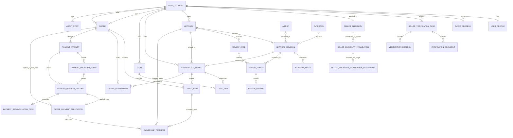
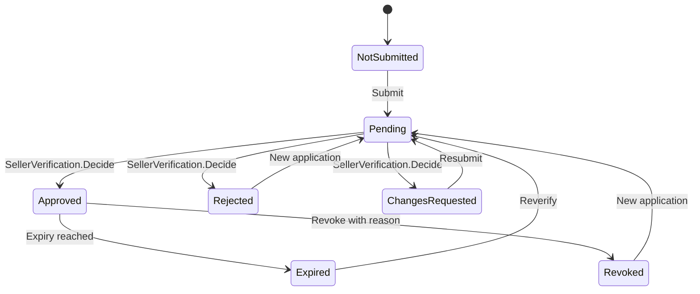
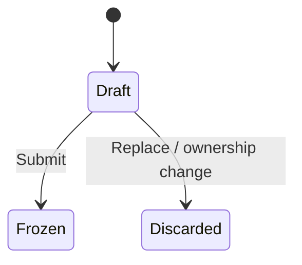
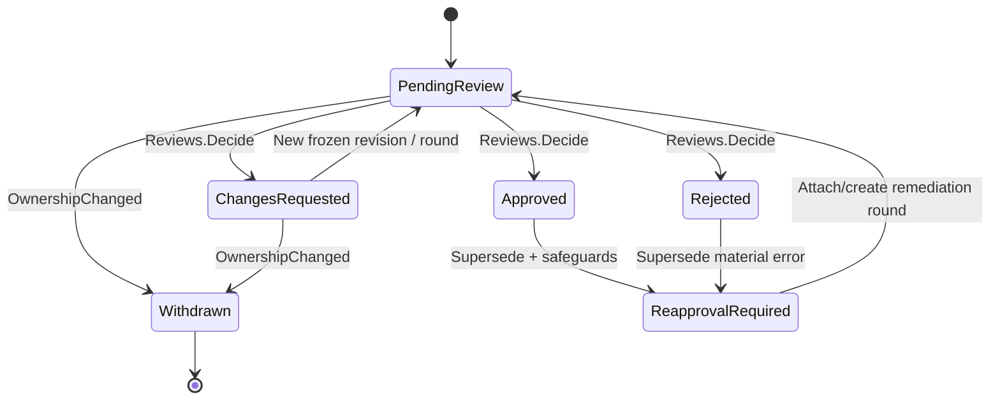
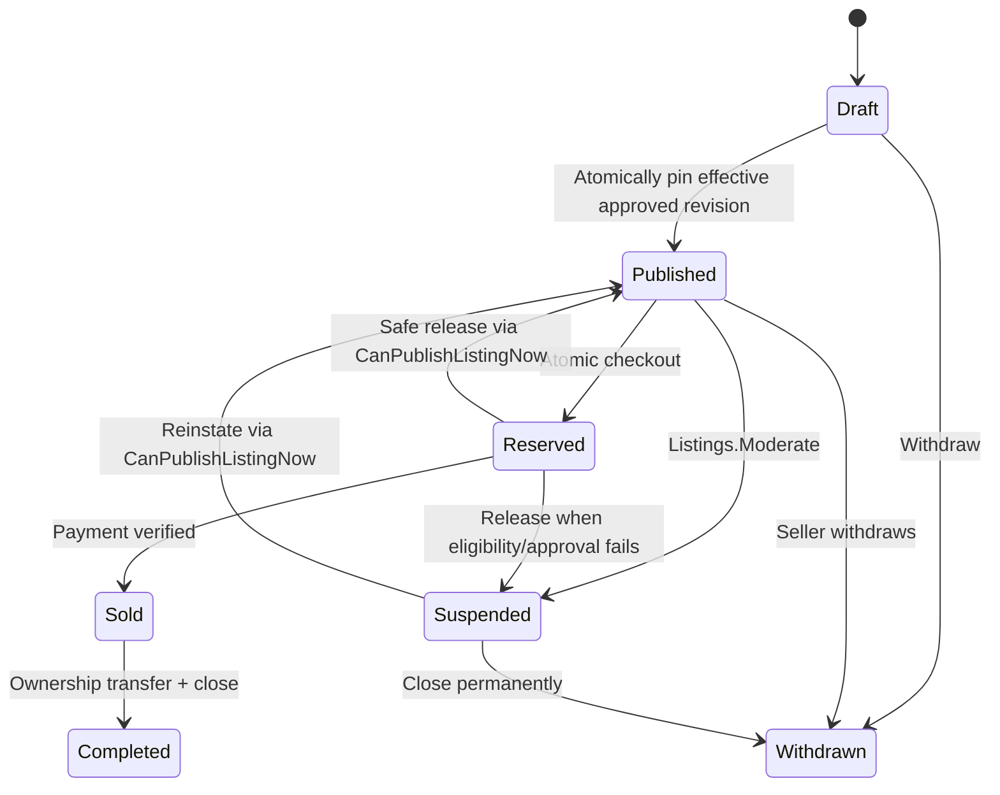
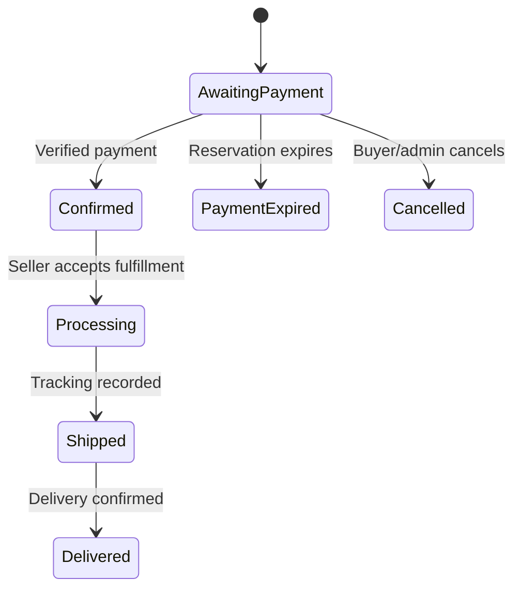
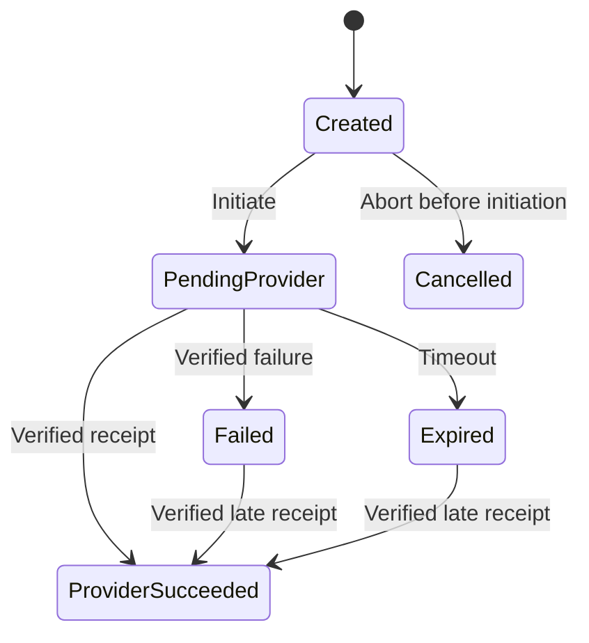

# مدل دامنه اولیه — بازار هنر V1

> وضعیت: پیشنهادی و در انتظار تأیید معماری  
> این مدل conceptual است؛ نام tableها و جزئیات EF در Phase 3 نهایی می‌شوند.

## ۱. زبان مشترک دامنه

- **User Account:** هویت ورود یک انسان؛ خریدار و فروشنده حساب جدا ندارند.
- **Seller Capability:** مجوز عملی فروش که از verification تأییدشده و منقضی‌نشده به دست می‌آید؛ role نیست.
- **Artwork:** هویت پایدار یک اثر فیزیکی یکتا و مالک فعلی آن.
- **Artwork Revision:** snapshot نسخه‌بندی‌شده مشخصات، تصاویر و provenance که می‌تواند بررسی شود.
- **Review Case / Round:** پرونده متعلق به Artwork است؛ هر دور تصمیم کارشناسی دقیقاً یک revision ثابت را بررسی می‌کند.
- **Marketplace Listing:** aggregate عرضه قیمت ثابت؛ در Draft فقط Artwork/price را نگه می‌دارد و هنگام انتشار revision تأییدشده دقیق را pin می‌کند.
- **Reservation:** حق موقت checkout روی listing؛ cart به‌تنهایی reservation نیست.
- **Order:** تعهد خرید با snapshot تغییرناپذیر مبلغ، طرفین و نشانی حمل.
- **Payment Attempt:** یک تلاش مستقل برای پرداخت یک Order؛ وضعیتش با Order یکی نیست.

## ۲. Aggregateها و مسئولیت‌ها

### Identity و Profiles

#### `UserAccount`

- حساب و credentialهای ASP.NET Core Identity
- وضعیت امنیتی، email/phone confirmation، lockout، MFA و security stamp
- roleهای عملیاتی: `User`, `Expert`, `Admin`, `SuperAdmin`

`Buyer` و `Seller` role نیستند. buyer capability از ثبت‌نام و تکمیل contact policy و seller capability از verification به دست می‌آید.

#### `UserProfile`

- نام نمایشی، اطلاعات تماس لازم، ترجیحات locale و اطلاعات عمومی فروشنده
- collection آدرس‌های ذخیره‌شده متعلق به کاربر
- PII فقط به اندازه نیاز V1 نگهداری می‌شود.

#### `SellerVerificationCase`

- applicant، status، زمان ارسال/تصمیم/انقضا
- verification documents با object key خصوصی
- decision history شامل actor، reason و timestamp
- هر تصمیم نهایی نسبت به version پرونده کنترل concurrency دارد.

`SellerEligibility` یک authorization guard/materialized summary با `EligibilityVersion` افزایشی است که از source-of-truth حساب و تاریخچه verification مشتق و در همان transaction تغییر آن‌ها به‌روز می‌شود؛ role نیست. هر disable/revoke/expire همراه version جدید، یک `SellerEligibilityInvalidation`/outbox work item append-only و پایدار با `InvalidatedVersion` می‌سازد؛ هر commercial snapshot با `SnapshotVersion < InvalidatedVersion` تحت آن invalidation است. reapproval نسخه جدیدی می‌سازد اما invalidation قبلی را پاک یا resolve نمی‌کند. resolution فقط با `SellerEligibilityInvalidationResolution` append-only و target-specific شامل actor/reason/evidence/audit مجاز است؛ reinstate/re-publish می‌تواند Listing را پس از resolution به نسخه جاری repin کند، اما snapshot immutable یک Order قدیمی را نوسازی ضمنی نمی‌کند.

### Catalog

#### `Artwork`

- `ArtworkId`
- `CurrentOwnerUserId`
- شناسه پایدار/کد داخلی اثر
- اطلاعات provenance سطح identity که با سیاست دقیق تعیین می‌شود

`Artwork` شامل price، listing status، bid یا auction status نیست.

#### `ArtworkRevision`

- شماره version ترتیبی درون Artwork
- `CreatedByOwnerUserId` برای بستن حق ویرایش Draft به مالک سازنده آن
- title، artist attribution، description، category، year، medium/materials، dimensions و condition
- reference تصاویر عمومی و اسناد خصوصی
- lifecycle کاتالوگ: `Draft`، `Frozen` یا terminal `Discarded` با reason اجباری مانند `Replaced`/`OwnershipChanged`؛ approval/rejection متعلق به Review است، نه enum این entity

create/edit/submit revision از guard مشترک `UserAccount/SellerEligibility → Artwork → ReviewCase` عبور می‌کند؛ ReviewCase موجود/موردنیاز پس از Artwork و در submit همیشه در همین ترتیب دیده می‌شود. پس از lock، actor باید seller مجاز و `Artwork.CurrentOwnerUserId` باشد و برای edit/submit باید با `CreatedByOwnerUserId` Draft نیز برابر باشد. برای هر Artwork حداکثر یک revision mutable در `Draft` وجود دارد؛ partial unique index این invariant را پس از guard دامنه تضمین می‌کند. هنگام submit، revision با concurrency token از Draft به Frozen می‌رود و ایجاد/ادامه ReviewCase و round در همان transaction انجام می‌شود. تغییر بعدی با revision جدید است؛ mutation بی‌صدای نسخه‌ای که کارشناس دیده ممنوع است.

`ArtworkAsset` فقط به object تمیزِ promotion‌شده اشاره می‌کند و `CleanObjectKey`, `Sha256`, size/type و `VersionId` اختیاری را pin می‌کند؛ quarantine key هیچ‌گاه عضو revision نیست. promotion روی همان byte stream/version اسکن‌شده به یک key سرور-فقط و create-if-absent انجام می‌شود و revision فریز‌شده asset/hash را immutable نگه می‌دارد.

#### `Artist`

- پروفایل مستقل و اختیاری برای نام استاندارد، biography، slug و اطلاعات عمومی
- seller الزاماً artist نیست و artist الزاماً User Account ندارد.
- هر `ArtworkRevision` یک `ArtistId` اختیاری و نام attribution snapshot دارد تا هم versioning دقیق بماند و هم آثار هنرمند ثبت‌نشده پشتیبانی شوند؛ `Artwork` این FK را تکرار نمی‌کند.

#### `Category`

- taxonomy مدیریتی با نام/slug، وضعیت فعال و ترتیب نمایش
- حذف category استفاده‌شده به deactivate تبدیل می‌شود.

### Expert Reviews

#### `ReviewCase`

- متعلق به یک `ArtworkId` و workflow ارسال آن Artwork
- submitter، assigned reviewer اختیاری و status پرونده
- یک یا چند `ReviewRound`؛ هر round به `ArtworkRevisionId` ثابت خودش اشاره می‌کند.
- conflict-of-interest policy: کارشناس صاحب/فروشنده اثر حق تصمیم‌گیری ندارد.

برای هر Artwork حداکثر یک ReviewCase non-terminal و در هر ReviewCase حداکثر یک `ReviewRound` در `PendingReview` مجاز است؛ partial unique indexها آخرین guard هستند. پس از `ChangesRequested` می‌توان زیر همان Artwork/ReviewCase lock یک Draft جدید ساخت و submit آن round بعدی همان case را باز می‌کند. دو submit هم‌زمان نمی‌توانند case/round رقیب بسازند: برنده Draft را freeze و round را ایجاد می‌کند و دیگری با concurrency/uniqueness conflict بدون side effect رد می‌شود.

#### `ReviewRound`

- revision ثابت، reviewer، findings و evidence reference
- decision: `Approved`, `Rejected`, `ChangesRequested`
- دلیل برای rejection/change request اجباری است.
- تصمیم ثبت‌شده append-only است و mutation نمی‌شود. اصلاح نگارشی فقط annotation ممیزی‌شده و بدون تغییر outcome است؛ خطای ماهوی با `ReviewDecisionSupersession` اصلاح می‌شود. supersession هرگز ReviewCase بسته را reopen نمی‌کند: زیر `Artwork → ReviewCase`، رکورد supersession، effective-status و واکنش محافظتی Listing/Order در یک transaction ثبت می‌شوند. اگر case non-terminal موجود است remediation به همان workflow پیوند می‌خورد؛ وگرنه case/round اصلاحی جدید روی revision فریز‌شده ساخته می‌شود. conflict یکتایی ناشی از submit هم‌زمان با reload/retry idempotent به case برنده attach می‌شود و حق ندارد ابطال approval یا safeguard را خنثی کند.

### Marketplace

#### `MarketplaceListing`

- `ArtworkId`, `SellerUserId` و `PublishedArtworkRevisionId` اختیاری در Draft
- `SellerEligibilityVersionAtPublish` که هنگام publish/reinstate/pin-swap معتبر بازنویسی می‌شود
- `Money` شامل amount و currency
- status مستقل listing
- public timestamps، suspension/withdrawal reason و concurrency version

طبق workflow قطعی V1، seller پیش از submit اثر یک Listing در حالت `Draft` با price/currency می‌سازد؛ `PublishedArtworkRevisionId` در این مرحله `null` و خارج از اختیار مستقیم seller است. review هنری قیمت را تأیید نمی‌کند. use case انتشار، approval مؤثر revision را زیر lock دوباره بررسی و pin را همراه transition به `Published` در یک transaction ثبت می‌کند. pin برای `Published/Reserved/Suspended/Sold/Completed` اجباری است؛ `Draft` و `Withdrawn`ای که هرگز publish نشده می‌توانند بدون pin باشند.

ساخت Draft از مسیر `CreateMarketplaceDraft` انجام می‌شود: UserAccount/SellerEligibility سپس Artwork قفل، `CurrentOwnerUserId == SellerUserId` و capability جاری revalidate و نبود Listing non-final زیر همان transaction بررسی می‌شود. در V2 نبود channel claim متعارض نیز لازم است؛ بنابراین pre-read قدیمی یا آزادشدن index پس از انتقال مالکیت به seller قبلی اجازه Draft stale نمی‌دهد.

یک اثر می‌تواند در طول عمر خود listingهای تاریخی متعدد داشته باشد، اما در V1 حداکثر یک listing non-final دارد. این invariant با partial unique index روی `Draft`, `Published`, `Reserved`, `Suspended`, `Sold` و یک use case متمرکز اجرا می‌شود. `Sold` تا انتقال صریح مالکیت lock را نگه می‌دارد و سپس به `Completed` می‌رود؛ بنابراین فروشنده قبلی در فاصله پرداخت تا انتقال مالکیت نمی‌تواند اثر را دوباره عرضه کند.

تمام مسیرهای ورود/بازگشت به `Published`—publish، reinstate و release پس از cancel/expiry—از `CanPublishListingNow` عبور می‌کنند: seller همان `CurrentOwnerUserId`، account و `SellerEligibility` معتبر، approval مؤثر همان `PublishedArtworkRevisionId`، نبود review/eligibility hold و سلامت constraint کانال. تعویض pin فقط برای revision تأییدشده، زیر همان guard و در `Published/Suspended` مجاز است؛ در `Reserved/Sold` ممنوع است.

checkout حق ندارد snapshot قدیمی Listing را با نسخه تازه Order «ترمیم» کند. زیر lock، هر Listing باید نسخه publish برابر نسخه جاری eligibility و فاقد invalidation حل‌نشده پوشاننده باشد؛ یک mismatch کل checkout چنداثری را بدون ایجاد Order/Reservation رد و Listingهای stale را همراه audit به `Suspended` می‌برد. فقط resolution صریح و reinstate/re-publish می‌تواند snapshot Listing را به نسخه جاری تغییر دهد.

### Orders

#### `Cart`

- متعلق به یک buyer ثبت‌شده
- فقط listingهای یک seller و یک currency
- quantity همیشه ۱ و هر listing حداکثر یک‌بار
- cart هیچ موجودی را نگه نمی‌دارد و guarantee قیمت/availability نیست.

#### `Order`

- buyer و seller
- `OrderItem`ها با `ArtworkId`, `ListingId`, title/artist summary و `PriceSnapshot`
- subtotal/total/currency سمت سرور
- `ShippingAddressSnapshot`
- order status، timestamps و version
- `SellerEligibilityVersionAtCheckout` و eligibility/hold resolution state
- `ReservationExpiresAtUtc` یکتا و immutable برای همه itemهای Order؛ مقدار از ساعت دیتابیس و TTL پیکربندی‌شده در checkout محاسبه می‌شود

V1 اجازه چند اثر از **یک فروشنده** در یک Order را می‌دهد. cart چندفروشنده‌ای، split order و settlement چندفروشنده‌ای خارج از scope است.

#### `ListingReservation`

- `OrderId`, `ListingId`, `ReservationToken`؛ deadline و snapshot eligibility مستقل ندارد و هر دو را فقط از Order والد می‌گیرد
- در همان transaction ایجاد Order، listing از `Published` به `Reserved` می‌رود.
- release فقط در صورت تطبیق token/order و عدم payment application انجام می‌شود؛ مقصد Listing با `CanPublishListingNow` تعیین و در وجود hold/eligibility/ownership/approval نامعتبر `Suspended` می‌شود.

درستی expiry در payment/release/cancel و lazy read فقط با timestamp دیتابیس در برابر `Order.ReservationExpiresAtUtc` بررسی می‌شود؛ schema اصلاً deadline فرزند ندارد تا اختلاف itemها ممکن شود. برای usability، یک `BackgroundService` درون همان monolith Orderهای candidate را بدون lock پایدار در batch کوچک پیدا و seller/همه Artworkهای هر Order را استخراج می‌کند. سپس UserAccount/SellerEligibility guard و همه Artwork guardهای مرتب را می‌گیرد (`SKIP LOCKED` فقط روی این guard prefix)؛ اگر هر guard لازم گرفته نشد، کل transaction بدون mutation skip می‌شود. پس از آن Review/Listing/Order قفل، deadline یکتای Order و همه reservationها/holdها دوباره خوانده و کل Order all-or-nothing terminal می‌شود. eligibility مفقود/نامعتبر یا هر hold مقصد Listing را `Suspended` می‌کند؛ هیچ Order چنداثری جزئی release نمی‌شود.

#### `OwnershipTransfer`

- `OrderId`, `OrderItemId`, `ArtworkId`, `ListingId`, `OrderPaymentApplicationId`
- `FromUserId`, `ToUserId`, trigger/evidence مصوب، idempotency key و زمان UTC
- unique constraint روی `OrderItemId` و `ListingId` برای این فروش

پیش از درج باید Order/Item/Listing/Artwork دقیقاً به هم تعلق داشته باشند، Order همان payment application مؤثر را داشته باشد، Listing در `Sold` باشد، `Artwork.CurrentOwnerUserId == Listing.SellerUserId == Order.SellerUserId` و `ToUserId == Order.BuyerUserId` باشد. درج transfer، terminal کردن Draftهای mutable ساخته مالک قبلی به `Discarded(reason=OwnershipChanged)`، withdraw کردن ReviewCase/round بازِ submitter قبلی با همان reason و audit، تغییر owner و `Sold → Completed` اتمیک و retry آن idempotent است؛ وجود hold آن را fail-closed متوقف می‌کند. revision فریز/منتشرشده و تصمیم‌های بسته‌شده تاریخچه immutable می‌مانند، اما مالک جدید draft یا حق ویرایش/ادامه review قبلی را به ارث نمی‌برد و برای تغییر باید revision/submission جدید بسازد.

### Payments

#### `PaymentAttempt`

- Order، provider key، provider transaction id و idempotency key
- amount/currency مورد انتظار
- request/verification timestamps و وضعیت مستقل؛ وضعیت جاری projection رویدادهای provider است
- payload حساس raw ذخیره یا log نمی‌شود؛ فقط داده لازم و redacted نگهداری می‌شود.

`PaymentProviderEvent` هر outcome تأییدشده provider را append-only و مستقل از اثر آن بر Order ثبت می‌کند. رویداد موفق پس از verification یک `VerifiedPaymentReceipt` با شناسه مستقل، `PaymentAttemptId`، `SourceProviderEventId` و provider transaction reference می‌سازد. یک Order می‌تواند چند attempt و حتی، در حالت خطا، چند receipt واقعی داشته باشد؛ هیچ receipt معتبر برای حفظ invariant حذف یا به failure تبدیل نمی‌شود. یکتایی `(ProviderKey, ProviderTransactionId)` برای receipt و `(ProviderKey, EventId)` برای event فقط replay/duplicate را مهار می‌کند.

#### `OrderPaymentApplication`

- اتصال دقیق یک `VerifiedPaymentReceiptId` موفق به اثر کسب‌وکاری روی Order؛ `PaymentAttemptId` فقط trace کمکی و قابل استخراج است
- unique constraint روی `OrderId` و نیز روی `VerifiedPaymentReceiptId`
- زمان، actor/system source و audit reference

برای هر Order حداکثر یک `OrderPaymentApplication` ساخته می‌شود. success به‌موقع فقط در transactionی که این رکورد را می‌سازد می‌تواند Order را `Confirmed` و listingها را `Sold` کند. دریافت دوم یا late success به‌طور کامل ثبت و وارد `PaymentReconciliationCase` می‌شود، اما خودکار به Order/Listing اعمال نمی‌شود. callback باید امضا/secret، freshness، replay، amount، currency، order reference و merchant account را کنترل و در صورت قابلیت provider به‌صورت server-to-server verify کند. success page مرورگر هیچ transition مالی ایجاد نمی‌کند.

الگوریتم persistence پس از verification: IDهای لازم ابتدا فقط برای برنامه lock خوانده می‌شوند؛ در transaction کوتاه، UserAccount/SellerEligibility و سپس Artwork/Review/Listing/Order طبق ترتیب سراسری قفل و state دوباره validate می‌شود. آنگاه event/receipt به‌شکل idempotent ثبت و دقیقاً یکی از مسیرهای application یا reconciliation انتخاب می‌شود. deadline Order با ساعت دیتابیس و نیز `SellerEligibilityVersionAtPublish` تک‌تک Listingها، `SellerEligibilityVersionAtCheckout` Order، برابری این snapshotها با نسخه جاری و نبود invalidation حل‌نشده پوشاننده همگی بررسی می‌شوند. هر mismatch/expiry application را fail-closed رد می‌کند، اما receipt معتبر را به reconciliation می‌برد. receiptهای متفاوت روی یک Order با همین guardها سریال می‌شوند؛ callback پیش از commit موفق acknowledge نمی‌شود.

### Administration و Audit

#### `SiteContentEntry`

- محتوای محدود و شناسه‌دار مانند banner و صفحه اطلاعاتی، با locale، draft/published state و version
- انتشار فقط از use case مدیریتی مجاز و auditable است.
- این aggregate برای CMS عمومی یا page builder طراحی نمی‌شود.

#### `AuditEntry`

- actor، action، target type/id، زمان UTC، reason، correlation id و metadata کمینه/غیرحساس
- append-only در سطح Application و قابل فیلتر برای Backoffice؛ credential مسیر writer در حد امکان حق `UPDATE/DELETE` ندارد.
- password، token، سند یا PII کامل در metadata قرار نمی‌گیرد.

این مدل به‌تنهایی storage را WORM/tamper-proof نمی‌کند. اگر الزام حقوقی چنین تضمینی داشته باشد، export امضاشده یا sink خارجی تغییرناپذیر همراه با retention policy لازم است.

## ۳. ER مقدماتی

رابطه‌های cross-module با ID/FK قابل اعمال‌اند، اما Domain navigation و query مستقیم جدول ماژول دیگر مجاز نیست.

## ۴. state machineها

### summary قابلیت فروشنده

این نمودار summary مشتق‌شده کاربر است، نه lifecycle یک پرونده mutable. هر درخواست جدید یک `SellerVerificationCase` جدید یا submission version جدید طبق policy می‌سازد و caseهای Rejected/Revoked تاریخی بازنویسی نمی‌شوند. `Approved` بودن role ایجاد نمی‌کند؛ policy در زمان عملیات، decision جاری و expiry را بررسی می‌کند.

### revision اثر

Revision ارسال‌شده immutable می‌ماند. outcome review در aggregate جدا ثبت می‌شود.

### review اثر

این نمودار outcome مؤثر بررسی برای یک revision/مسیر انتشار را نشان می‌دهد، نه lifecycle قابل‌بازشدن یک ReviewCase تاریخی. هر round به revision ثابت خودش اشاره می‌کند و outcome هر revision از آخرین decision non-superseded زنجیره همان revision به‌دست می‌آید؛ ارسال revision جدید approval revision قبلی را خودکار باطل نمی‌کند. `LatestApprovedRevision` فقط read model بازسازی‌پذیر میان revisionهای دارای approval مؤثر است و state مستقل در Catalog محسوب نمی‌شود. اگر هنگام supersession workflow دیگری از قبل `PendingReview` باشد، همان workflow remediation را می‌گیرد ولی approval revision هدف فوراً نامعتبر و Listing pin‌شده به آن محافظت می‌شود؛ case بسته قدیمی هرگز reopen نمی‌شود. ابطال approval بدون واکنش محافظتی state-specific و اتمیک برای Listing/Order وابسته مجاز نیست.

انتقال مالکیت، ReviewCase/round بازِ ایجادشده توسط مالک قبلی را با status `Withdrawn` و reason ممیزی‌شده `OwnershipChanged` می‌بندد. revision فریز‌شده حذف یا بازنویسی نمی‌شود و approval/pin تاریخی معتبر برای نمایش فروش انجام‌شده باقی می‌ماند؛ این تاریخچه به مالک جدید حق edit/resume نمی‌دهد.

### listing بازار قیمت ثابت

`Suspended` و `Sold` تا تعیین تکلیف lock را نگه می‌دارند؛ عرضه دیگری برای همان Artwork نباید فعال شود. trigger حقوقی انتقال مالکیت هنوز تصمیم باز است، اما آزادسازی lock فقط همراه تغییر صریح owner و `Sold → Completed` در یک transaction رخ می‌دهد.

ابطال ماهوی approval، stateهای تجاری را جعل یا عقب‌گرد نمی‌دهد: `Draft` در همان state می‌ماند ولی دیگر قابل publish نیست؛ `Published → Suspended` اتمیک است؛ برای `Reserved` یک `ReviewIntegrityHold` روی Order/Reservation ثبت و اعمال پرداخت/فروش خودکار مسدود می‌شود؛ expiry/cancel می‌تواند Order و Reservation را terminal کند ولی Listing فقط `Suspended` می‌شود و hold/incident را نگه می‌دارد؛ برای `Sold` fulfillment/ownership-transfer hold و refund/legal case لازم است؛ `Withdrawn/Completed` تغییر state نمی‌دهند و فقط incident/audit می‌گیرند. default بدون auto-sale/auto-republish/auto-unlock است.

ابطال/انقضای seller verification یا disable شدن account نیز fail-safe است: invalidation work item و version جدید ابتدا durable می‌شوند؛ Draft منتشر نمی‌شود؛ Published به‌صورت idempotent Suspended می‌شود؛ Reserved یک `SellerEligibilityHold` می‌گیرد و هنگام cancel/expiry فقط به Suspended آزاد می‌شود؛ Sold یک fulfillment/ownership-transfer hold و incident می‌گیرد؛ final stateها فقط audit می‌شوند. mismatch snapshot با هر version بعدی تا resolution صریح معتبر نمی‌شود، پس worker crash یا reapproval سریع پنجره فروش ایجاد نمی‌کند.

### سفارش

تا پیش از تصویب refund/cancellation policy، Order پرداخت‌شده transition مستقیم به `Cancelled` ندارد. رخداد استثنایی فقط case مدیریتی قابل ممیزی می‌سازد و state مالی را جعل نمی‌کند.

### پرداخت

`ProviderSucceeded` واقعیت دریافت وجه است، نه مجوز ضمنی fulfillment. در مسیر به‌موقع، ایجاد یکتای `OrderPaymentApplication` و transitionهای Order/Listing در یک transaction انجام می‌شود. late success یا دریافت اضافه `PaymentReconciliationCase` می‌سازد و Order/Listing را خودکار به فروش موفق تبدیل نمی‌کند. callback تکراری همان event/receipt side effect دوم ایجاد نمی‌کند، اما receipt واقعاً متفاوت حذف نمی‌شود.

## ۵. invariantهای غیرقابل مذاکره

1. یک حساب می‌تواند هم buyer و هم seller باشد؛ seller capability از verification معتبر می‌آید.
2. در V1 فروشنده باید مالک فعلی اثر باشد؛ consignment نیازمند تصمیم محصولی جداست.
3. هر transition به `Published` و هر revision-pin swap فقط زیر `CanPublishListingNow` و commercial guard، برای owner دارای account/seller eligibility معتبر و همان revision تأییدشده مجاز است.
4. price مثبت و settlement currency پیکربندی‌شده است و فقط در Listing/Order snapshot قرار می‌گیرد، نه Artwork؛ display unit/conversion جداست.
5. ویرایش اطلاعات قابل‌اعتماد/عمومی اثر revision و review جدید می‌خواهد؛ listing فعلی محتوای تأییدشده قبلی را نشان می‌دهد تا تعویض صریح انجام شود.
6. در V1 برای هر Artwork حداکثر یک Listing non-final در حالت `Draft`, `Published`, `Reserved`, `Suspended` یا `Sold` وجود دارد؛ فقط `Withdrawn/Completed` lock را آزاد می‌کنند.
7. listing رزروشده فقط توسط همان Order و reservation token قابل آزادسازی/فروش است.
8. seller نمی‌تواند listing خود را بخرد.
9. checkout به policy صریح `CanCheckout` نیاز دارد: account فعال، contactهای مصوب و shipping address کامل؛ سپس همه قیمت‌ها و availability از سرور بازخوانی می‌شوند و داده cart معتبر نهایی نیست.
10. رزرو listing و ایجاد Order در یک transaction هستند؛ موفقیت یکی بدون دیگری مجاز نیست.
11. فقط verification سمت سرور از provider می‌تواند receipt موفق ثبت کند؛ فقط ایجاد اتمیک `OrderPaymentApplication` می‌تواند Order را Confirmed کند.
12. idempotency key، provider transaction id و callback event id برای scope مربوط یکتا هستند؛ receiptهای واقعی همگی ثبت می‌شوند، اما هر Order حداکثر یک `OrderPaymentApplication` دارد.
13. document خصوصی هیچ public URL پایدار ندارد و endpoint دانلود ownership/role را بررسی می‌کند.
14. Expert حق بررسی اثر خودش را ندارد.
15. دلیل برای reject، request changes، suspend، revoke و privilege change اجباری است.
16. همه عملیات حساس audit می‌شوند و زمان در storage UTC است.
17. manual cancel/expiry، Order و همه Reservation/Listingهایش را all-or-nothing می‌بندد؛ مقصد هر Listing فقط با policy جاری و eligibility snapshot/version سازگار `Published` و در غیر این صورت `Suspended` است.
18. هر OrderItem حداکثر یک `OwnershipTransfer` دارد؛ from/to و Artwork/Listing/Order/payment application باید دقیقاً مطابق snapshot و owner جاری باشند.
19. `ReservationExpiresAtUtc` و `SellerEligibilityVersionAtCheckout` فقط روی Order نگهداری می‌شوند؛ Reservation فرزند هیچ deadline/version مستقلی ندارد و همه itemها در یک لحظه و با یک نسخه ارزیابی می‌شوند.
20. یک mismatch eligibility در هر Listing، کل checkout را پیش از ساخت Order/Reservation رد می‌کند؛ Listing قدیمی با audit `Suspended` می‌شود و reapproval به‌تنهایی آن را احیا نمی‌کند.
21. create/edit/submit revision فقط برای owner/capability جاری زیر Artwork lock مجاز است؛ انتقال مالکیت Draft mutable و review باز مالک قبلی را اتمیک terminal می‌کند و آن‌ها را به مالک جدید واگذار نمی‌کند.
22. برای هر Artwork فقط یک Draft mutable، یک ReviewCase non-terminal و برای هر case فقط یک round `PendingReview` مجاز است؛ submit هم‌زمان دقیقاً یک برنده دارد.
23. supersession تصمیم همیشه append-only است و case تاریخی را reopen نمی‌کند؛ race با submit باید به case فعال برنده attach/retry شود و هیچ unique conflict نباید safeguard ابطال approval را حذف کند.

## ۶. مرزهای transaction حیاتی

| Use case | عملیات اتمیک |
|---|---|
| Create/edit/submit artwork revision | lock `User/SellerEligibility → Artwork → ReviewCase` + revalidate owner/capability، `CreatedByOwnerUserId` و نبود Draft/case/round رقیب؛ در submit، transition شرطی Draft→Frozen + بازکردن case/round یکتا + audit |
| Expert decision/supersession | lock `Artwork → ReviewCase` + optimistic check + append decision/supersession + update effective status + attach/create remediation workflow بدون reopen case بسته + واکنش محافظتی state-specific برای Listing/Order + audit؛ unique/serialization conflict با reload/retry idempotent |
| Seller/account invalidation | تغییر canonical `SellerEligibility`/version + درج durable invalidation/outbox + revoke session لازم؛ سپس suspension/holdهای state-specific idempotent، بدون حذف marker در reapproval |
| Create listing Draft | lock `User/SellerEligibility → Artwork` + revalidate owner/capability/channel + بررسی نبود listing non-final + insert Draft |
| Publish/reinstate/revision swap | `CanPublishListingNow` + بررسی owner/eligibility/effective approval/hold + snapshot نسخه eligibility + pin مجاز + transition/constraint |
| Checkout | lock User/eligibility و Artworkهای مرتب + lock listingها + الزام current/valid eligibility، تطبیق snapshot همه Listingها و نبود invalidation حل‌نشده؛ mismatch کل checkout را بدون Order/Reservation رد و staleها را `Suspended` می‌کند؛ در موفقیت نسخه و deadline یکتا فقط روی Order snapshot و reservationها all-or-nothing ساخته می‌شوند |
| Payment verification | lock/revalidation طبق ترتیب `User/SellerEligibility → Artwork → Review → Listing → Order` + کنترل deadline Order و snapshotهای Order/همه Listingها، سپس ثبت idempotent event/receipt و یکی از دو مسیر: ایجاد یکتای `OrderPaymentApplication` + Order transition + listing `Sold`، یا حفظ receipt اضافه/دیرهنگام + reconciliation؛ همه همراه audit و retry امن conflict |
| Manual cancel | زیر guard: `AwaitingPayment → Cancelled` + terminal کردن همه reservationها + transition همه listingها به `Published` یا `Suspended` طبق policy جاری، all-or-nothing |
| Ownership transfer | درج یکتای `OwnershipTransfer` با پیوند exact OrderItem/Listing/Artwork/payment + کنترل from/to/hold + terminal کردن Draft/review باز مالک قبلی + تغییر owner + `Sold → Completed`، با trigger حقوقی مصوب |
| Reservation expiry | candidate بر پایه deadline یکتای Order + گرفتن SellerEligibility و همه Artwork guardهای مرتب (`SKIP LOCKED` فقط guard prefix؛ count ناقص = no-op/rollback) + revalidation hold/token/version + terminal کردن all-or-nothing؛ Listing واجد policy `Published` و Listing held/ineligible `Suspended` |

ارسال notification بعد از commit انجام می‌شود. failure اعلان نتیجه مالی یا review ثبت‌شده را rollback نمی‌کند.

برای جلوگیری از race، مسیرهای cross-module از ترتیب `UserAccount/SellerEligibility (UserId مرتب، اگر لازم) → Artwork (ArtworkId مرتب) → ReviewCase → MarketplaceListing → Order → Payment records` پیروی می‌کنند. این قاعده create/edit/submit revision، create Listing Draft، supersession، eligibility invalidation/resolution، publish/reinstate، revision swap، checkout، expiry، manual cancel/release، callback و ownership transfer را پوشش می‌دهد. lookup اولیه فقط برنامه lock می‌سازد و authorization/ownership/eligibility/approval/hold پس از lock دوباره بررسی می‌شود. retry deadlock/serialization محدود، idempotent و قابل مشاهده است.

## ۷. سیاست ویرایش بعد از تأیید

پیشنهاد امن V1:

- title، artist، category، year، medium، dimensions، condition، description، تصاویر و provenance هر تغییری داشته باشند، revision و review جدید لازم است.
- price جزو review هنری نیست و با ruleهای Marketplace قابل تغییر است؛ تغییر قیمت listing رزروشده ممنوع است.
- اطلاعات صرفاً عملیاتی مانند internal note عمومی نیست و review مجدد نمی‌خواهد، ولی authorization و audit خودش را دارد.
- listing منتشرشده به `PublishedArtworkRevisionId` pin می‌شود. revision جدید تا تأیید و عملیات صریح و اتمیک «تعویض نسخه منتشرشده» روی صفحه عمومی دیده نمی‌شود؛ swap فقط در `Published/Suspended` و با `CanPublishListingNow` مجاز و در `Reserved/Sold` ممنوع است.

## ۸. پرسش‌های دامنه‌ای باز

- انتقال مالکیت حقوقی در پرداخت، تحویل به حمل‌کننده یا تحویل نهایی رخ می‌دهد؟
- فروش وکالتی/نمایندگی مجاز است یا فقط مالک اثر؟
- آیا تأیید چند کارشناس یا assignment اجباری نیاز است؟
- تعریف حقوقی categoryهای اثر و مدارک اصالت چیست؟
- cancellation، return، dispute و refund پس از پرداخت چه policy دارند؟
- shipping fee و مسئول fulfillment چگونه محاسبه می‌شود؟
- مدت reservation و رفتار پرداخت موفق دیرهنگام چیست؟
- retention و حق حذف verification/provenance documents چقدر است؟
