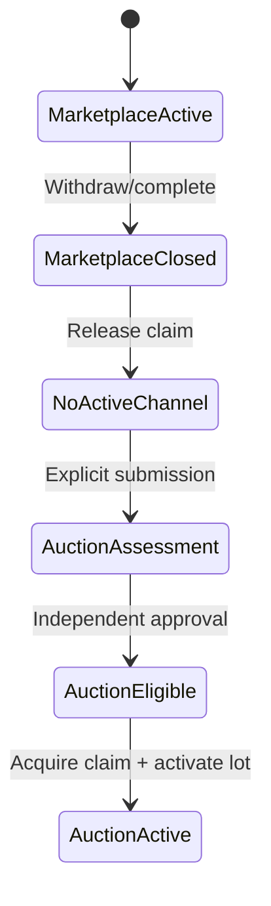

# آمادگی معماری برای V2 — بدون پیاده‌سازی Auction

> این سند فقط migration path را تعریف می‌کند. در V1 هیچ `AuctionSubmission`، `AuctionLot`، `Bid`، SignalR hub، scheduler حراج، verification سطح ۳ یا endpoint/UI حراج ساخته نمی‌شود.

## ۱. اصل راهنما

V1 نباید یک «Marketplace نصفه‌حراجی» بسازد. آمادگی V2 با سه مرز واقعی تأمین می‌شود:

1. هویت و revision اثر مستقل از هر کانال فروش است.
2. Marketplace workflow و state model مختص قیمت ثابت می‌ماند.
3. تمام فعال‌سازی/غیرفعال‌سازی عرضه از use caseهای متمرکز عبور می‌کند تا invariant بین‌کانالی در V2 بدون بازنویسی UI یا Catalog اضافه شود.

## ۲. اجزای قابل استفاده مجدد

| مؤلفه V1 | استفاده در V2 |
|---|---|
| Identity و role/policy | حساب شرکت‌کننده، کارکنان و authorization پایه |
| Profiles & Verification | contact، نشانی و verificationهای فعلی؛ Auction Eligibility جدا اضافه می‌شود. |
| Artwork و ArtworkRevision | هویت، مالکیت، metadata و provenance یکسان |
| Object Storage | تصاویر و مدارک با همان مدل public/private |
| Expert Reviews infrastructure | history، reviewer، findings و audit قابل استفاده است؛ track حراج مستقل خواهد بود. |
| Orders | ایجاد Order برای برنده با source جدید و snapshot قیمت نهایی |
| Payments | provider abstraction، idempotency و verification |
| Notifications | adapter/template/delivery؛ templateهای حراج جدا |
| Audit و observability | actor/correlation و ردگیری عملیات حساس |

«قابل استفاده مجدد» به معنی یکی کردن workflow نیست؛ مثلاً review بازار، eligibility حراج را به‌طور خودکار صادر نمی‌کند.

## ۳. ماژول‌های جدید V2

- **Auction Eligibility:** قواعد و بررسی مستقل صلاحیت seller/artwork/participant برای حراج
- **Auctions:** submission، event، lot، زمان‌بندی و lifecycle حراج
- **Bidding:** ledger پیشنهادها، ترتیب server-authoritative، minimum increment و anti-sniping
- **Winner Assignment:** assignmentهای ترتیبی، deadline مستقل هر برنده و promotion بعدی
- **Realtime Adapter:** انتشار نتیجه commit‌شده از طریق SignalR؛ منبع حقیقت نیست
- **Auction Settlement:** کمیسیون/settlement فقط پس از تعیین مدل حقوقی و مالی

هیچ‌یک از این ماژول‌ها در V1 placeholder code یا table نخواهند داشت.

## ۴. invariant یک اثر / یک کانال فعال

### V1

- invariant داخلی Marketplace با partial unique index روی `MarketplaceListing(ArtworkId)` برای statusهای non-final (`Draft`, `Published`, `Reserved`, `Suspended`, `Sold`) بیش از یک listing باز/درحال‌تسویه را منع می‌کند.
- publish، withdraw، suspend و sale فقط از application service متمرکز Marketplace عبور می‌کنند.

این invariant با claim کانال یکی نیست: `Draft` هنوز عرضه فعال نیست؛ در مقابل `Sold` تا انتقال مالکیت، commercial lock را نگه می‌دارد.

چون Draft claim نمی‌گیرد ولی در unique index داخلی Marketplace non-final است، نباید پس از فعال‌شدن Auction یا تغییر مالکیت stale بماند. در V2، activation/ownership-transfer orchestration زیر Artwork guard همه Draftهای Marketplace همان Artwork را که با کانال یا owner جدید ناسازگارند اتمیک به `Withdrawn` با reason ممیزی‌شده می‌برد؛ در غیر این صورت Auction activation/transfer fail می‌شود.

### migration پیشنهادی V2

یک table مشترک افزوده می‌شود:

```text
ArtworkChannelClaim
-------------------
ArtworkId           PK, FK -> Artwork
Channel             Marketplace | Auction
OfferingId          UUID
ClaimedAtUtc         timestamptz
Version              bigint
```

کلید اصلی `ArtworkId` تضمین دیتابیسی می‌دهد که یک اثر فقط یک claim فعال دارد. قرارداد transaction:

1. وضعیت owner/eligibility/review کانال هدف بررسی شود.
2. Draftهای Marketplace ناسازگار/stale همان Artwork اتمیک Withdraw شوند و partial unique index دوباره ارزیابی شود.
3. claim در همان transaction insert شود؛ conflict یعنی اثر در کانال دیگری فعال است.
4. Marketplace Listing یا Auction Lot فعال شود.
5. هنگام پایان قطعی عرضه، status بسته و claim در همان transaction آزاد شود؛ ownership transfer نیز Draft مالک قبلی را invalidate می‌کند.

`Suspended` claim را نگه می‌دارد؛ تعلیق نباید راه دور زدن exclusivity باشد.

### rollout بدون race

1. table و index جدید با migration backward-compatible افزوده شود.
2. publish جدید موقتاً متوقف یا dual-write فعال شود.
3. فقط listingهای claim-holding یعنی `Published`, `Reserved`, `Suspended` و `Sold` منتظر انتقال backfill شوند؛ `Draft` claim نمی‌گیرد.
4. use case اتمیک withdrawal/invalidation Draft برای Auction activation و ownership transfer deploy و روی Draftهای stale موجود backfill شود.
5. تمام activationها ملزم به claim و precondition عدم Draft ناسازگار شوند.
6. سپس Auction activation فعال شود.

هیچ foreign key polymorphic به Marketplace/Auction لازم نیست؛ `OfferingId` همراه `Channel` برای correlation است و هر ماژول existence متعلق به خودش را در transaction/use case کنترل می‌کند.

## ۵. تغییر صریح کانال فروش



- هیچ `MarketplaceListing` به `AuctionLot` تبدیل نمی‌شود.
- price، review decision و history Marketplace به auction rule تبدیل یا کپی ضمنی نمی‌شوند.
- transition reverse نیز workflow و eligibility خودش را دارد.
- فعال‌سازی Auction یا انتقال مالکیت، Draft بازار قیمت ثابت را به مالک جدید منتقل نمی‌کند؛ Draft مالک قبلی با reason بسته می‌شود و مالک جدید در صورت نیاز Draft خودش را می‌سازد.

## ۶. review و revision در V2

- `ArtworkRevision` همان واحد immutable بررسی باقی می‌ماند.
- V2 یک review purpose/track مستقل مانند `AuctionEligibility` اضافه می‌کند.
- approval Marketplace برای همان revision، approval Auction نیست.
- تغییر trust-sensitive یک revision جدید می‌سازد و هر track بر اساس policy خودش آن را بررسی می‌کند.
- evidence/history مشترک فقط با authorization صریح قابل مشاهده است؛ decisionها مستقل‌اند.

## ۷. Orders، Payments و مهلت ۱۵ دقیقه‌ای

- V1 `Order` source خود را Marketplace می‌داند؛ در V2 migration یک `AuctionWinnerAssignmentId` یا sale source قراردادی اضافه می‌کند.
- قیمت Order از bid برنده snapshot می‌شود و دیگر از Listing نمی‌آید.
- deadline پانزده‌دقیقه‌ای روی `WinnerAssignment` قرار دارد، نه `PaymentAttempt` یا listing.
- هر promotion یک `WinnerAssignment` جدید با `AssignedAtUtc` و `PaymentDeadlineUtc` مستقل می‌سازد.
- payment verification همچنان server-authoritative و idempotent است.
- پرداخت دیرهنگام assignment قبلی وارد reconciliation policy می‌شود و حق برنده بعدی را خودکار تغییر نمی‌دهد.

## ۸. ordering و realtime آینده

- bid ابتدا در PostgreSQL و با ordering/concurrency rule سرور commit می‌شود.
- SignalR فقط رخداد commit‌شده را منتشر می‌کند؛ پیام client یا ترتیب رسیدن SignalR منبع حقیقت نیست.
- anti-sniping با transaction و clock سرور زمان پایان را تغییر می‌دهد.
- scheduler و background job حراج در V2 طراحی می‌شوند و در V1 placeholder ندارند.

## ۹. migrationهای احتمالی V2

- ایجاد schema/moduleهای Auction Eligibility، Auctions، Bidding و Winner Assignment
- افزودن `ArtworkChannelClaim` و backfill عرضه‌های باز
- افزودن sale source به Order/OrderItem با default امن برای رکوردهای V1
- افزودن review purpose/track و migration داده‌های V1 به `MarketplacePublication`
- افزودن idempotent job/outbox infrastructure برای schedule و realtime projection
- indexهای زمان/وضعیت برای شروع و پایان حراج و index ترتیبی bid
- policy/migration برای verification سطح Auction Eligible، بدون تغییر roleهای کاربر

### قابلیت‌های V2 پیرامون حمل و بیمه

- **Shipping Preferences:** توسعه `Profiles/Addresses` و `Orders/Shipping` با preferenceهای مقصد/تحویل؛ به Bid یا AuctionLot چسبانده نمی‌شود.
- **Map-based Address Selection:** فقط geocoding/reference مکانی روی Address اضافه می‌کند؛ متن نشانی snapshot سفارش همچنان منبع تاریخی است و مختص Auction نیست.
- **Optional Artwork Insurance:** policy/quote/coverage یک ماژول یا adapter مستقل در کنار Shipping/Settlement خواهد بود؛ هیچ column حدسی بیمه در V1 ساخته نمی‌شود.
- انتخاب بیمه و حمل پس از assignment برنده به snapshot سفارش/settlement متصل می‌شود و deadline پرداخت را ضمنی تغییر نمی‌دهد.

## ۱۰. ریسک‌های مهاجرت ناشی از تصمیم‌های V1

| ریسک | محافظ V1 |
|---|---|
| price یا status فروش روی Artwork قرار گیرد | ممنوع؛ فقط Listing مالک آن‌هاست. |
| review به Listing گره بخورد | review به ArtworkRevision متصل است. |
| UI فرض کند تنها یک نوع sale برای همیشه وجود دارد | API از route/use case مختص Marketplace استفاده می‌کند؛ generic sale UI نمی‌سازیم. |
| Order فقط FK اجباری Listing داشته باشد | OrderItem snapshot دارد؛ source قابل تکامل است. |
| publish در چند نقطه پراکنده شود | یک application service متمرکز activation دارد. |
| زمان محلی یا clock مستقیم استفاده شود | UTC + `IClock` قابل آزمون از V1. |
| reservation V1 با deadline برنده حراج یکی شود | دو مفهوم و owner متفاوت مستند می‌شوند. |
| claim backfill با publish هم‌زمان race کند | rollout مرحله‌ای و dual-write/maintenance window. |
| Draft بدون claim پس از Auction/تغییر مالکیت، seller جدید را block کند | activation/transfer زیر Artwork guard Draft ناسازگار مالک قبلی را Withdraw و index/precondition را دوباره بررسی می‌کند. |
| enumهای V1 مقادیر V2 را زودتر اضافه کنند | هیچ مقدار Auction در schema/code V1 ایجاد نمی‌شود. |

## ۱۱. آزمون‌های معماری که در V1 باید اضافه شوند

- Domain `Catalog` به `Marketplace` وابسته نباشد.
- `Artwork` propertyهایی مانند `Price`, `Bid`, `AuctionStatus`, `ListingStatus` نداشته باشد.
- Marketplace namespace هیچ reference به نوع future Auction نداشته باشد.
- API routeهای V1 هیچ `/auctions` یا `/bids` نداشته باشند.
- migrationهای V1 هیچ table/column مختص Auction نسازند.
- فقط مسیر application تعیین‌شده بتواند listing را `Published` کند.

## ۱۲. آزمون‌های لازم هنگام پیاده‌سازی V2 — نه در V1

- migration/backfill claim هم‌زمان با publish کنترل و بدون dual active channel اجرا شود.
- Auction activation در حضور Draft بازار، آن Draft را زیر Artwork guard اتمیک Withdraw کند یا کل activation fail شود.
- ownership transfer حراج، Draft مالک قبلی را invalidate کند و unique index stale مانع ایجاد Draft مالک جدید نشود.
- race activation/transfer با ایجاد Draft جدید، یا cleanup کامل و claim معتبر بسازد یا بدون mutation fail شود.

هیچ fixture، route، table یا test double حراج برای اجرای این سناریوها در V1 ساخته نمی‌شود؛ این فهرست contract پذیرش آینده V2 است.

## ۱۳. معیار آمادگی V2 در پایان V1

V1 زمانی از نظر معماری آماده V2 است که:

- Artifact هویت اثر و revision تأییدشده مستقل از listing باشد.
- history review و provenance قابل reuse ولی decisionها قابل تفکیک باشند.
- تمام active listingها قابل backfill به claim table باشند.
- policy migration/cleanup Draftهای بدون claim برای activation و ownership transfer مستند شده باشد؛ اجرای race-test آن متعلق به V2 است.
- Order/Payment به snapshot و contract متکی باشند، نه object graph Marketplace.
- Marketplace activation و transaction boundaryهای V1 تست‌شده و boundary آینده Auction فقط مستند باشد.
- هیچ feature حدسی Auction بار نگهداری V1 ایجاد نکرده باشد.
